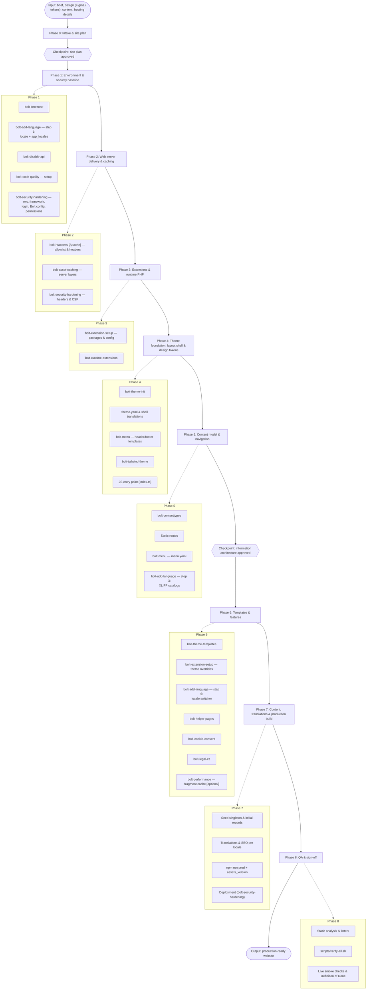

# Bolt CMS End-to-End Website Build Workflow

This master workflow takes a brief, a visual design (Figma wireframes, design tokens) and content, and turns them into a production-ready, secure and performant [Bolt CMS](https://boltcms.io) 6 website using the 18 skills in this repository.

The phases are ordered by real dependencies: every step only needs what earlier steps produced. Each phase ends with a **gate** (verifications that must pass, then a commit). Steps marked **[if …]** depend on the answers recorded in the Phase 0 site plan.

---

## How to Read and Run This Workflow

- **Working directory.** Every command runs from the root of the Bolt project. Set the skills location once per shell:
  ```bash
  SKILLS=vendor/tomvondracek/bolt-skills/skills          # installed with: composer require --dev tomvondracek/bolt-skills
  # SKILLS=/path/to/bolt-skills/skills             # when using a checkout of this repository instead
  ```
- **Verify scripts.** Run a skill's verification with `bash $SKILLS/<skill>/scripts/verify.sh`. The scripts locate the project root from the current directory.
- **Live HTTP checks.** `bolt-disable-api`, `bolt-htaccess` and `bolt-security-hardening` request URLs from a running site. They use `BOLT_BASE_URL` (default `http://127.0.0.1:8000`), so point it at **this** project before running them, otherwise they test whatever else is listening on that port. (`bolt-asset-caching` finds a Symfony CLI server for the project on its own; its end-to-end delivery check runs against Apache started with its `scripts/serve-apache.sh`, or `BOLT_DELIVERY_URL`.)
  ```bash
  export BOLT_BASE_URL=http://localhost:8080
  ```
- **Applied vs. verified.** Several skills are applied across more than one phase (for example `bolt-extension-setup` installs packages in Phase 3 and adds theme templates in Phase 6). Their verification only passes once every part exists. [Appendix A](#appendix-a-skill-to-phase-map) lists where each skill is applied and where its verification is expected to pass. Do not chase failures from a verification that is scheduled for a later phase.
- **Precedence.** The skills implement the [Integration Contract](#integration-contract-single-source-of-truth); if a project deviates from it, record the deviation in the site plan. What the verification scripts cannot check automatically is listed in [Appendix B](#appendix-b-known-limitations).
- **Translations.** Every skill that renders text ships its units in `examples/translations.<locale>.xlf`. Merge them into the project's catalogs with `php vendor/tomvondracek/bolt-skills/scripts/merge-xliff.php <skill catalog> translations/messages.<locale>.xlf` — it adds missing units and never overwrites existing translations.
- **Running it end to end.** The `bolt-build` skill executes this workflow from a design (Figma, Pencil, images, an existing site or a brief): it reads the design, asks every question of Phase 0 and the skills in one upfront intake, and then runs Phases 1–8 autonomously, logging progress in the project's `AGENTS.md`.
- **Existing projects.** To check a site that already exists instead of building one, use the `bolt-audit` skill: it runs every skill's verification read-only, reviews the skills one by one and reports findings with the phase and skill that fix them.
- **Commit after every gate** (`git commit -m "Phase N: …"`) so any phase can be rolled back on its own.
- **Final verification** runs all skills in phase order: `vendor/tomvondracek/bolt-skills/scripts/verify-all.sh` (see [Phase 8](#phase-8-qa--sign-off)).

---

## Master Execution Graph



---

## Integration Contract (Single Source of Truth)

The skills meet in a few shared places: the master layout, the theme folder structure, the colour tokens, the JavaScript hooks, the URLs and the translation keys. These conventions apply to every phase. If the project needs a different convention, record it in the site plan (Phase 0) and apply it consistently.

### Theme Files & Layout

| Concern | Contract |
| :--- | :--- |
| Active theme | `public/theme/<theme>/`, linked by `theme: <theme>` in `config/bolt/config.yaml`; `name: <theme>` in `theme.yaml` |
| Master layout | `partials/_master.twig` with the blocks `seo`, `head`, `header`, `main`, `footer`, `scripts` (skeleton below) |
| Standalone layout | `helper-pages/_helper_template_without_master.twig` — no header, footer, menu or database access. Used by the 503 **and** 500 pages |
| Pure components | `components/ui/`, `components/nav/`, `components/brand/` — never call `setcontent`, receive all data as parameters |
| Smart containers | `containers/header/_menu.twig`, `containers/footer/_footer.twig`, `containers/<area>/_<name>.twig` — may call `setcontent` and `menu_array()` |
| Pages | `pages/<name>/<name>.twig` (listing or singleton page), `pages/<name>/<name>.record.twig` (record detail), `pages/<name>/components/` (page-scoped components) |
| Partials | `partials/_master.twig`, `partials/_locale-switcher.twig`, `partials/_cookie-banner.twig`, `partials/_consent-mode.twig`, `partials/_consent-embed.twig`, `partials/_cookie-table.twig`, `partials/_privacy-macros.twig`, `partials/_privacy-form-note.twig` |
| Static pages | `static-pages/<name>.twig`, served through `TemplateController` routes (see [Static Routes](#static-routes)) |
| Error & maintenance pages | `helper-pages/` |
| Extension templates | `extensions/llms.txt.twig` (the sitemap needs no theme template) |
| Template binding | ContentType `record_template` / `listing_template` point either directly at `pages/<name>/…` or at a one-line root entrypoint that `` it (for example `product.twig`). The generic root `index.twig`, `record.twig` and `listing.twig` are fallbacks and never point at one specific ContentType's pages |
| CSS | Source `css/tailwind/index.css` → build output `css/index.css` (never edit the output) |
| JavaScript | Source `js/src/index.ts` (imports the modules) → build output `js/app.js` |
| Asset URLs | `{{ asset('css/index.css') }}?v={{ theme.assets_version }}`. Bolt registers the active theme as the default asset package on frontend and error pages, so paths are relative to the theme folder. Bump `assets_version` in `theme.yaml` with every CSS/JS release |
| Site facts | `theme.yaml` → `contact:` (email, phone, registered address, company ID), `socials:`, `analytics:` (tracking IDs), `privacy:` (controllers, purposes, recipients, cookie inventory — the single source for the cookie banner and the privacy page, `bolt-cookie-consent`), `legal:` (operator type, register entry, DIČ, consumer information — the footer identity of `bolt-legal-cz`). Read in Twig as `theme.contact.email` or `config.get('theme/contact/email')`. A whole block (`config.get('theme/legal')`) comes as a Bolt collection: convert it first — `` — otherwise a key set to `~` throws on access (the page answers 500) and `|column()` finds nothing |

### Master Layout Skeleton (`partials/_master.twig`)

`bolt-theme-init` creates this file. Every page, static page and the 404/403 helper pages extend it; each skill plugs into one of its blocks or partials. Partials owned by other skills are included with `ignore missing`, so the shell renders from the moment `bolt-theme-init` has run:

```twig
{#
  partials/_master.twig — the single layout shell of the theme.

  Every page orchestrator, static page and the 404/403 helper pages extend this file
  and fill . Other skills plug into the named blocks and partials:

    seo      bolt-extension-setup (AppoloDev/bolt-seo); helper and static pages override it
    head     page-specific additions (helper scene styles, carousel CSS, preloads)
    header   bolt-menu: containers/header/_menu.twig (navigation, CTA, locale switcher, mobile menu)
    main     page content
    footer   bolt-menu: containers/footer/_footer.twig (columns, legal links, cookie settings)
    scripts  page-specific scripts

  Partials owned by other skills are included with `ignore missing`, so the shell
  renders as soon as bolt-theme-init has run and fills in as later skills add them.
#}
<!DOCTYPE html>
<html lang="{{ htmllang() }}" class="scroll-smooth antialiased">
<head>
    <meta charset="utf-8">
    <meta name="viewport" content="width=device-width, initial-scale=1.0">

    {# https://github.com/AppoloDev/bolt-seo #}
    
        <title>{{ seo.title() }}</title>
        {{ seo.metatags() }}
        {# bolt-add-language: hreflang alternates of this page in every locale #}
        
    

    {# bolt-cookie-consent: consent configuration (JSON) for js/src/cookie-consent.ts — no tracker loads before consent. #}
    

    {# Bolt registers the active theme as the default asset package, so asset() paths are
       relative to public/theme/<theme>/. Bump assets_version in theme.yaml on every release
       (bolt-asset-caching serves CSS/JS with long-lived cache headers). #}
    <link rel="stylesheet" href="{{ asset('css/index.css') }}?v={{ theme.assets_version|default('1.0') }}">
    <script defer src="{{ asset('js/app.js') }}?v={{ theme.assets_version|default('1.0') }}"></script>

    
</head>
<body class="flex min-h-screen flex-col bg-canvas text-ink font-body selection:bg-accent selection:text-accent-ink">

    {# a11y skip link for keyboard and screen-reader users #}
    <a href="#obsah"
       class="sr-only focus:not-sr-only focus:fixed focus:top-4 focus:left-4 focus:z-50 focus:px-4 focus:py-2 focus:bg-accent focus:text-accent-ink focus:font-semibold focus:rounded-sm focus:outline-none">
        {{ __('a11y.skip_to_content') }}
    </a>

    {# bolt-cookie-consent: cookie banner (renders only when theme.yaml privacy.cookies needs consent).
       Early in the DOM so keyboard users reach it right after the skip link (CB-60). #}
    

    
        
    

    <main id="obsah" class="flex-1 focus:outline-none" tabindex="-1">
        
    </main>

    
        
    

    
</body>
</html>
```

### Design Tokens

- Token names are defined by `bolt-tailwind-theme` in `css/tailwind/index.css`: surfaces `canvas`, `surface`, `surface-2`; text `ink`, `ink-2`, `ink-3`; `stroke`; brand `accent`, `accent-hover`, `accent-soft`, `accent-ink`, `accent-ink-2`; dark zone `night`, `night-deep`, `night-stroke`, `night-ink`, `night-ink-2`, `night-ink-3`; fonts `display`, `body`, `mono`; text sizes `hero`, `section`, `card`, `micro`, `meta`, `body`, `lead`; spacing `header`; breakpoint `menu`.
- `bolt-theme-init`'s baseline `css/tailwind/index.css` uses the same names with neutral values, so templates render before the design tokens exist; `bolt-tailwind-theme` replaces the **values**, never the names.
- All template examples (`bolt-menu`, `bolt-theme-templates`, `bolt-cookie-consent`, `bolt-add-language`, `bolt-theme-init`) use only these tokens, plus Tailwind defaults used on purpose (layout, spacing, `white`, the `emerald` / `amber` status colours).
- `bash $SKILLS/bolt-theme-templates/scripts/verify.sh` (check [7/10]) lists classes used in templates that the compiled `css/index.css` does not contain — the symptom of an undefined token name.

### JavaScript Hooks

All behaviour ships with `bolt-theme-init` (`js/src/*.ts`) and `bolt-cookie-consent` (`js/src/cookie-consent.ts`); the markup ships with `bolt-menu`, `bolt-add-language` and `bolt-cookie-consent`.

| Hook | Markup (who renders it) | Behaviour (module) |
| :--- | :--- | :--- |
| `[data-dropdown-toggle="<id>"]` → `#<id>.dropdown` | Submenu buttons (`components/nav/dropdown.twig`), locale switcher | Accordion: `aria-expanded` / `aria-controls`, `inert` while closed, height animated via `.dropdown`, click or ArrowDown opens (focusing the first link), Escape closes and refocuses, outside click closes (`menu.ts`) |
| `[data-menu-toggle]`, `[data-mobile-menu="drawer"]`, `[data-menu-backdrop]`, `[data-menu-close]` | Header container (`containers/header/_menu.twig`): opener, `<aside id="mobile-drawer">`, backdrop, close button and drawer links | Drawer: slides in, shows the backdrop, locks body scroll, traps focus, Escape / backdrop / close button / link closes it and returns focus (`menu.ts`). `data-mobile-menu="collapse"` switches to a height-animated panel |
| `[data-sticky-header]` | The sticky `<header>` element | Height subtracted from anchor scroll targets (`auto-scroll.ts`) |
| `[data-locale-switch]` | Every link in `partials/_locale-switcher.twig` | Keeps scroll position, query string and hash across a language switch (`locale-switcher.ts`) |
| `.photoswipe-gallery` > `a.photoswipe-gallery__link` with `data-pswp-width` / `data-pswp-height` | Galleries (`components/ui/picture.twig` with `pswp: true`) | Lightbox with deep-linking (`photoswipe.ts`) |
| `[data-cookie-banner]`, `[data-cookie-dialog]`, `[data-cookie-accept]`, `[data-cookie-reject]`, `[data-cookie-save]`, `[data-cookie-close]`, `[role="switch"][data-cookie-category]` | `partials/_cookie-banner.twig` | Two-layer consent banner (`cookie-consent.ts`) |
| `[data-cookie-settings]` | Banner, footer "Nastavení cookies" button, privacy page, embed placeholders | Opens the consent settings (`cookie-consent.ts`; also `window.cookieConsent.open()`) |
| `[data-consent-embed]`, `[data-consent-embed-load]`, `script[type="text/plain"][data-consent-category]` | `partials/_consent-embed.twig`, further trackers | Load only after consent with their category (`cookie-consent.ts`) |
| `[data-cookie-banner-defer]` | Privacy page | The banner does not cover that page |

### Links, Locales & Translations

- **Locales.** `locale` and `app_locales` in `config/services.yaml` are the single source. ContentType `locales:`, menu label maps, XLIFF catalogs and the locale switcher list exactly these codes.
- **Internal links** always go through `locale_link('/path')`, also on single-language sites (the menu, template and cookie-banner examples call it everywhere, so `LocaleLinkExtension` is always installed). Menu links are written without a locale prefix; anchors are written as `/#section`.
- **Translation keys** are dotted keys (`cookie.accept`, `products.title`, `a11y.skip_to_content`) stored in `translations/messages.<locale>.xlf` (XLIFF 2.0). Use `{{ __('key') }}` or `{{ 'key'|trans }}`. Every key used in a template must exist in every catalog: a missing key renders as the key itself, and `|default('…')` after `__()` never applies because the key string is not empty (`bolt-theme-templates`' verification reports that pattern).
- **Shipped units.** `bolt-theme-init`, `bolt-menu`, `bolt-theme-templates`, `bolt-cookie-consent` and `bolt-add-language` each ship `examples/translations.cs.xlf` and `examples/translations.en.xlf` with every key their templates use. Merge them with `scripts/merge-xliff.php`; for further locales, merge the English catalog into `messages.<code>.xlf` and translate the targets.

### Static Routes

Pages without a ContentType (privacy policy as a static page, legal notices, thank-you pages) are served by Bolt's `TemplateController`. Add the routes to `config/routes.yaml` **above** the `frontend:` import. The sitemap (`tomvondracek/bolt-sitemap`) lists every such route without parameters, and pairs the `<name>_locale` twin of the **same template** with it as the page's other languages (`bolt-extension-setup` section 2.4). Every static page therefore needs both routes on a multilingual site:

```yaml
# config/routes.yaml
privacy:
  path: /zasady-ochrany-osobnich-udaju
  defaults:
    _controller: Bolt\Controller\Frontend\TemplateController::template
    templateName: static-pages/gdpr.twig

# Locale-prefixed variant (e.g. /en/zasady-ochrany-osobnich-udaju). Symfony sets the request
# locale from {_locale}, which __() / |trans and locale_link() pick up. Multilingual sites only.
privacy_locale:
  path: /{_locale}/zasady-ochrany-osobnich-udaju
  requirements: { _locale: '%app_locales%' }
  defaults:
    _controller: Bolt\Controller\Frontend\TemplateController::template
    templateName: static-pages/gdpr.twig
```

---

## Phase 0: Intake & Site Plan

**Goal:** decide everything later phases depend on, before any file changes.

**Inputs:** project brief, design (Figma file or exported tokens), sitemap and copy, **who operates the website** (OSVČ – živnostník, company, regulated profession, non-business) and what the site does for consumers (`bolt-legal-cz` intake: consumers, ADR body, online contracts, reviews, whistleblowing), operator details for the privacy policy (legal name, company ID / IČO, registered address, registry entry, privacy e-mail, data protection officer if any — for every business on the site), the answers to `bolt-cookie-consent`'s intake (trackers, embeds, controller model, processing purposes, recipients), tracking IDs (GA4, Google Ads, Sklik, Meta), hosting details (web server, document root, Docker or not), domain.

### 0.1 Write the Site Plan

Record the answers in the project's `AGENTS.md` under a `## Site plan` heading, so every later session (and every agent) reads the same decisions:

```markdown
## Site plan
- Theme folder: <theme>
- Locales: default cs; secondary en, de            (or: cs only)
- Timezone: Europe/Prague
- Hosting: Apache, document root = project root    (or: Apache vhost on public/ | Nginx in Docker)
- Deployment: SFTP upload                          (or: git pull on the server | CI)
- Production domains (SYMFONY_TRUSTED_HOSTS): ^(www\.)?example\.cz$ ; staging: …
- Admin access: open                               (or: IP allowlist <ip> | HTTP basic auth)
- Local URL (BOLT_BASE_URL): http://localhost:8080
- Menu profile: landing | catalog | conditional
- ContentTypes: name — singleton? routable? fields
- Pages & URLs per locale; anchor sections on the homepage
- Static pages (TemplateController routes): /zasady-ochrany-osobnich-udaju, …
- Features: gallery yes/no, downloads yes/no, carousel yes/no, catalog/products yes/no, articles yes/no
- Tracking: none | GA4 <id> | Google Ads <id> | Sklik <id> | Meta <id>; Consent Mode: basic | advanced
- Embeds: none | YouTube | Google Maps | Mapy.com
- Legal (bolt-legal-cz intake): operator trade | company | profession | other; IČO; consumers yes/no (ADR body); online contracts yes/no; reviews yes/no; whistleblowing / accessibility / regulated profession
- Privacy (bolt-cookie-consent intake): controller model single | joint | separate | hybrid; controllers; purposes; recipients; open [DOPLNIT] questions for the operator
- Public API consumers: none (disable) | <who> (lock down instead)
- Error-page metaphor: <industry object or scene>
- Expected verification warnings (with reason): …
```

### 0.2 Decision Matrix

| Question | If yes | If no |
| :--- | :--- | :--- |
| **More than one language?** | List every code in `app_locales` (1.2). Per-locale menu labels (5.4), one XLIFF catalog per locale (5.5), ContentType `locales` (5.1), locale switcher (6.3). `verify-all.sh` verifies `bolt-add-language` once per secondary locale | `app_locales` contains only the default code. Skip 6.3. `verify-all.sh` skips `bolt-add-language` automatically. Keep `LocaleLinkExtension` |
| **One-page site with anchor sections?** | Menu profile `landing`; links `/#section`; matching `id` attributes on the homepage sections | Profile `catalog` (hierarchical pages with submenus) or `conditional` (event-style site whose sections appear only when content exists) |
| **Product / catalog listing?** | `products` ContentType (5.1); `bolt-theme-templates` adds `pages/product/`, the featured-products container and the root `product.twig` / `product.record.twig` entrypoints (6.1) | Nothing to do: `bolt-theme-templates`' scaffold skips the product pages when `contenttypes.yaml` has no `products` (`--products=auto`) |
| **Photo gallery?** (any grid or list of photos — it always opens in the lightbox, even when the design does not show one) | `ImageDimensionsExtension` (3.2); `photoswipe.ts` imported (4.5); `.photoswipe-gallery` > `a.photoswipe-gallery__link` (`components/ui/picture.twig` with `pswp: true`, or own tiles with the same contract), `.photoswipe-gallery__caption` from the alt text, `gallery.*` labels as `data-pswp-*` attributes (6.1); caption CSS (`bolt-tailwind-theme` 5.H) | Remove the `photoswipe` import, the `photoswipe` npm dependency and its CSS `@import` |
| **Downloadable files?** | `FileSizeExtension` (3.2); `field.path|file_size|format_file_size` | `FileSizeExtension` optional |
| **Carousel?** | Load `css/splide_4.1.2.min.css` and `js/splide_4.1.2.min.js` (from `bolt-theme-init`) in the `head` block of the pages that use it | Delete the Splide files |
| **Analytics, marketing tracking or third-party embeds?** | Two-layer cookie banner, Consent Mode v2, Sklik and embeds behind consent (6.5). Decide basic (trackers load only after consent, default) vs. advanced Consent Mode (`analytics.consent_mode` in `theme.yaml`) — advanced only on the operator's explicit decision | No banner (`bolt-cookie-consent/scripts/scaffold.sh --no-banner`). The privacy page is still required (server logs, contact data); `verify.sh` then checks the page only |
| **Who operates the website?** (always asked; usually an OSVČ – živnostník) | `bolt-legal-cz` (6.6) renders name, seat, IČO and the register entry for that operator type in the footer of every page — Trade Register for a živnostník, court / section / file for a company, the chamber list for a regulated profession; ARES confirms the data | Never assumed — ask (`bolt-legal-cz` AG-01) |
| **Sells to consumers?** (services count: plumber, hairdresser, photographer) | ADR body with its web address in the footer (ČOI unless energy, telecoms, finance or legal services), complaints information, prices with VAT, review notice under testimonials (6.6) | B2B only: the identity is still required |
| **Contracts concluded on the website?** (cart, paid booking, subscription) | Terms and conditions, complaints procedure, withdrawal notice and model form, „Objednávka zavazující k platbě“, the „Odstoupit od smlouvy“ button from 1. 1. 2027, accessibility unless a microenterprise (6.6) | Enquiry forms only: nothing extra |
| **More than one business on the website?** | Ask `bolt-cookie-consent`'s two controller-model questions (joint / separate / hybrid) — never guess the model | Controller model `single` |
| **Apache?** | `bolt-htaccess` (2.1); root `.htaccess` only when the domain's document root is the project root | Nginx: use the Nginx block of `bolt-asset-caching` (2.2); run `verify-all.sh --skip=bolt-htaccess` |
| **Docker?** | `bolt-timezone` INI and compose layers (1.1); Nginx block (2.2) if the container uses Nginx | `bolt-timezone` config and Kernel layers only |
| **Deployed by uploading files (SFTP / FTP)?** | Committed `.env` holds every production value including `APP_SECRET`, so the upload runs on its own; `.env.local` is local development only and never uploaded; excluded upload paths, `var/cache/prod/` deleted after each upload (`bolt-security-hardening` Steps 1, 7) | Same `.env` rules; the deploy script runs `cache:clear` |
| **Editors other than the site's own staff?** | Keep SVG and iframes out (`bolt-security-hardening` Step 4) and consider the strict CSP (Step 6b) | Same defaults — they cost nothing |
| **External consumers of the REST/GraphQL API?** | Lock down permissions instead of the deny-all firewall rule (1.3); run `verify-all.sh --skip=bolt-disable-api` and test the endpoints manually | Fully disable the API (default) |

### Checkpoint 0

Show the site plan to the user and get approval. Do not start Phase 1 until the plan is approved; changing locales, ContentTypes or hosting later means repeating several phases.

---

## Phase 1: Environment & Security Baseline

**Goal:** the project boots with correct time handling, known locales, no public API, hardened security configuration and code-quality tooling in place.

**Prerequisites:**
- A Bolt 6.1 project that boots: `composer create-project bolt/project <dir>`, SQLite from Bolt's default `.env` (set `DATABASE_URL` in `.env.local` only for another local database), `php bin/console bolt:setup --no-fixtures` (no sample content), local server reachable at the URL recorded as `BOLT_BASE_URL`.
- Skills installed: `composer require --dev tomvondracek/bolt-skills`.
- Git initialised with a clean baseline commit.
- Node.js and npm available (needed from Phase 4).

### 1.1 Timezone Parity (`bolt-timezone`)
- Set `timezone: Europe/Prague` (and `date_format`) in `config/bolt/config.yaml`, add the `boot()` override to `src/Kernel.php`, set `date.timezone` in `docker/php/conf.d/bolt.dev.ini` / `bolt.prod.ini` **[if Docker]**, add `TZ` to the database service in `compose.yaml` **[if Docker database]**.
- `php bin/console cache:clear`
- *Verify:* `bash $SKILLS/bolt-timezone/scripts/verify.sh`

### 1.2 Locale Parameters (`bolt-add-language`, Step 1 only)
- Set `locale` (default language) and `app_locales` (pipe-separated list, e.g. `cs|en|de`) in `config/services.yaml`; update `locales_array` too if the file defines it. Single-language site: `app_locales: cs`.
- **Why now:** routing requirements, ContentType locale validation (Phase 5) and `LocaleLinkExtension` (Phase 3) all read these parameters.
- The remaining `bolt-add-language` steps are spread over the phases that own those files: Step 2 in 5.1, Step 3 in 5.5, Step 4 in 5.4, Step 6 in 6.3, Step 5 and Step 7 in Phase 7. Its verification runs in Phase 8, once per secondary locale.

### 1.3 API Lockdown (`bolt-disable-api`)
- Keep the `api_platform` route loader and `api_entrypoint` registered (the admin listings generate IRIs from those routes; removing them breaks the dashboard with "Unable to generate an IRI"), set the documentation and GraphiQL flags in `config/packages/api_platform.yaml`, revoke `api:*` permissions in `config/bolt/permissions.yaml`, add the `^/api(/|$)` → `ROLE_NO_ACCESS` firewall rule as the first `access_control` entry (keep Bolt core's entity path in `mapping.paths`).
- **[if the site plan lists API consumers]** replace the deny-all firewall rule with the permission lock-down only.
- `php bin/console lint:yaml config --parse-tags && php bin/console cache:clear`
- *Verify:* `bash $SKILLS/bolt-disable-api/scripts/verify.sh` (the HTTP part needs the running site and `BOLT_BASE_URL`; otherwise it reports SKIPPED and is repeated in Phase 8).

### 1.4 Code-Quality Tooling (`bolt-code-quality`, setup)
- Install the dev dependencies, add the composer scripts (`lint`, `lint:fix`, `phpstan`), create `ecs.php`, `phpstan.dist.neon`, the `Makefile` targets and `.gitlab-ci.yml` (replace `<theme_name>` in the `twig` job with the theme folder from the site plan).
- **Why now:** every PHP file added later (Phase 3) is linted from the moment it is written.
- `make cscheck` must pass on the stock project.
- *Verify:* `bash $SKILLS/bolt-code-quality/scripts/verify.sh`

### 1.5 Application Security Baseline (`bolt-security-hardening`, Steps 1–5)
- **`.env`:** every production value from `examples/env`: `APP_ENV=prod`, `APP_DEBUG=0`, a fresh `APP_SECRET` (the generate command of Step 1), `SYMFONY_TRUSTED_HOSTS` and `BOLT_CANONICAL` from the site plan, and the production `DATABASE_URL` / `MAILER_DSN`. It is committed and uploaded. The local `.env.local` is `examples/env.local` only: `APP_ENV=dev`, `APP_DEBUG=1`, an empty `SYMFONY_TRUSTED_HOSTS` and an empty `BOLT_CANONICAL`, and no `APP_SECRET`.
- Copy `config/packages/security_hardening.yaml` and `config/validator/user.yaml`; `login_throttling` (5 / 15 minutes) in `security.yaml`; `bolt.remember_lifetime: 604800`.
- Merge the security keys into `config/bolt/config.yaml` (upload whitelist, HTML cleaner without `iframe`, `query_search` off, no version disclosure, `verify_peer: true`, reset-password notice off) and `config/bolt/permissions.yaml` (file editor for config / themes off, `ROLE_DEVELOPER` not assignable).
- `php bin/console lint:yaml config --parse-tags && php bin/console cache:clear`
- *Verify:* `bash $SKILLS/bolt-security-hardening/scripts/verify.sh` — the file sections pass now; the live section is repeated in Phase 8.

### Gate 1
Verifications 1.1, 1.3 (configuration part), 1.4 and 1.5 (file sections) pass. Commit.

---

## Phase 2: Web Server Delivery & Caching

**Goal:** the web server serves only what it should and caches static files and thumbnails correctly.

### 2.1 Apache `.htaccess` Shielding (`bolt-htaccess`) **[if Apache]**
- `public/.htaccess` from the skill's template: `AddDefaultCharset UTF-8`, the allowlist for `theme/`, `files/` and `thumbs/` (only built assets and accepted upload types are served), the safety-net `FilesMatch` deny list, the security headers for static files (HSTS, nosniff, sandboxed uploads), the Symfony front-controller rules.
- Root `/.htaccess` with the HTTPS redirect and the rewrite into `public/` **only** when the domain's document root is the project root.
- The templates redirect plain HTTP both with and without a TLS proxy (`%{HTTPS} off` + `X-Forwarded-Proto !https`) and deny `node_modules/`, `.git/` and `.env*` in addition to the source-file patterns.
- *Verify:* `bash $SKILLS/bolt-htaccess/scripts/verify.sh` (the live part is repeated in Phase 8, once the theme exists).

### 2.2 Asset & Thumbnail Caching (`bolt-asset-caching`, Steps 1–4)
- Add `thumbs` to the `dev` firewall pattern in `config/packages/security.yaml`.
- Set `thumbnails.save_files: true` in `config/bolt/config.yaml` (the upload whitelist was set in 1.5).
- **[if Apache]** add the `mod_expires` rules to the **same** `<IfModule mod_expires.c>` block created in 2.1 — one block, not two.
- **[if Nginx]** add the `/thumbs` location and the static-asset `expires` block to `docker/nginx/conf.d/default.conf`.
- Step 5 (cache-busting `?v=`) is implemented by the master layout from 4.1 (`?v={{ theme.assets_version }}`).
- *Verify:* `bash $SKILLS/bolt-asset-caching/scripts/verify.sh`

### 2.3 Security Headers and CSP (`bolt-security-hardening`, Step 6)
- Replace `config/packages/nelmio_security.yaml` with the skill's example: clickjacking `DENY`, nosniff, one referrer policy, `Permissions-Policy`, the enforced baseline CSP, no deprecated `xss_protection`, no `forced_ssl`.
- **[if a form posts to an external service]** add its host to `form-action`.
- The strict CSP (Step 6b) is optional: start it as Report-Only after the trackers are wired (6.5), enforce later.
- **[if Docker / Nginx]** `examples/docker/nginx_security.conf` and `php_security.ini` (Step 9).

### Gate 2
Verifications 2.1 and 2.2 pass; `bolt-security-hardening` reports the baseline CSP (2.3). Commit.

---

## Phase 3: Extensions & Runtime PHP

**Goal:** every extension and custom Twig function the content model and templates rely on is installed before they are used.

### 3.1 Essential Extensions (`bolt-extension-setup`, Part A: packages & configuration)
- `composer require appolodev/bolt-seo:^2.3 tomvondracek/bolt-sitemap:^1.0 tomvondracek/bolt-llms-txt:^1.1`
- `php bin/console extensions:configure --with-config`
- `php bin/console assets:install --symlink --relative public`
- Configure `config/extensions/appolo-boltseo.yaml` (fallback chains; the field names are revisited in 5.2; `default.robots`, never the dead `meta_robots`; `templates.meta` is set in 6.2 together with the partial it names), `config/extensions/tomvondracek-sitemap.yaml` (copy the skill's `examples/tomvondracek-sitemap.yaml`; keep `static_routes: true`, `images.fields` for ContentTypes whose first image is not the page's) and `config/extensions/tomvondracek-llmstxt.yaml` (`template: '@theme/extensions/llms.txt.twig'`, `locale`, `max_age`).
- Confirm `bolt/redactor` and `bolt/article` are in `composer.json` (they ship with `bolt/project`). Phase 5 uses the field types `redactor`, `article` and `seo`, which these packages and `appolodev/bolt-seo` provide.
- Part B (theme templates and the SEO block) is done in 6.2.
- *Verify (partial):* `bash $SKILLS/bolt-extension-setup/scripts/verify.sh` — checks [1/7] to [3/7] pass now; [4/7] to [7/7] pass after 5.1 and 6.2.

### 3.2 Runtime Twig Extensions (`bolt-runtime-extensions`)
- `bash $SKILLS/bolt-runtime-extensions/scripts/scaffold.sh` installs into `src/`. Bolt's `App\` resource registers the classes and their `#[Autowire]` attributes inject `%app_locales%`, `%locale%` and `%kernel.project_dir%`, so `config/services.yaml` needs no service definitions:
  - `LocaleLinkExtension` — `locale_link(path)`: prefixes internal links with the current locale (default locale stays unprefixed), keeps query strings and hashes, leaves external URLs and pure `#fragments` untouched.
  - `ImageDimensionsExtension` — `image_dimensions(url)`: cached disk probe (Symfony cache, invalidated by file `mtime`) that gives PhotoSwipe 5 the intrinsic width and height of images without a media-library entry.
  - `FileSizeExtension` — `|file_size` and `|format_file_size`: human-readable sizes for catalogs and download links.
- Existing `src/*Extension.php` files are kept unless `--force` is given.
- Keep `LocaleLinkExtension` on every site. Keep `ImageDimensionsExtension` **[if gallery/lightbox]** and `FileSizeExtension` **[if downloads]**; removing an unused one makes the verification report a warning, which is listed as expected in the site plan.
- The scaffold adds `app_locales: cs|en` only when the parameter is missing; 1.2 already set it.
- `php bin/console cache:clear`
- *Verify:* `bash $SKILLS/bolt-runtime-extensions/scripts/verify.sh`, then `make cscheck` (lints the new files in `src/`).

### Gate 3
Verifications 3.1 (partial) and 3.2 pass, `make cscheck` passes. Commit.

---

## Phase 4: Theme Foundation, Layout Shell & Design Tokens

**Goal:** a theme that builds, renders the homepage with the real header and footer, uses the design's tokens and has working navigation scripts. Page content comes in Phase 6.

### 4.1 Scaffold the Theme (`bolt-theme-init`)
- `bash $SKILLS/bolt-theme-init/scripts/scaffold.sh <theme>` (existing files are kept unless `--force`).
- Creates the contract folders (`partials/`, `components/{ui,nav,brand}`, `containers/{header,footer,contact}`, `pages/`, `static-pages/`, `helper-pages/`, `extensions/`, `css/{tailwind,article,fonts}`, `js/src`), the tooling (`package.json`, `rollup.config.js`, `tsconfig.json`, `postcss.config.mjs`), the baseline `css/tailwind/index.css` (contract token names, neutral values), the TypeScript modules (`auto-scroll.ts`, `menu.ts` with dropdown accordions and the mobile drawer/collapse menu, `locale-switcher.ts`, `photoswipe.ts`, `index.ts`), Splide, the Bolt Article/Redactor CSS, `theme.yaml`, `macros.twig`, the layout shell `partials/_master.twig`, the generic fallbacks `record.twig` / `listing.twig`, a placeholder homepage (`pages/homepage/homepage.twig` with the `bolt-theme-init:placeholder` marker) and `index.twig`.
- Links the theme in `config/bolt/config.yaml` and runs `npm install`, `npm update --save` and `npm run prod`.

### 4.2 Theme Settings & Shell Translations
- Fill `theme.yaml`: `name` (= folder), `assets_version: '1.0'`, `logo.default` / `logo.light` (paths relative to the theme), `contact:` (name and address exactly as registered — the registered seat, quoted IČO, email, phone, hours, bio — used by the footer, contact containers, privacy page, helper pages and `llms.txt`), `analytics:` **[if tracking]** (`ga4_id`, `google_ads_id`, `sklik_id`, `consent_mode`), `socials:`. The `privacy:` block is appended by `bolt-cookie-consent` in 6.5, the `legal:` block by `bolt-legal-cz` in 6.6.
- Merge `$SKILLS/bolt-theme-init/examples/translations.<locale>.xlf` (keys of the master layout and fallbacks) — see 5.5 for the loop.

### 4.3 Navigation Shell (`bolt-menu`, templates)
- `bash $SKILLS/bolt-menu/scripts/scaffold.sh --profile=<landing|catalog|conditional> --templates --force`
- `--force` is required: `bolt/project` ships a sample `config/bolt/menu.yaml`, and without `--force` the script stops before copying the templates. The menu content written here is a placeholder; 5.4 replaces it with the real information architecture.
- Copies `components/nav/item.twig`, `components/nav/dropdown.twig`, `components/brand/logo.twig`, `containers/header/_menu.twig` and `containers/footer/_footer.twig` — already wired to the `menu.ts` hooks, the contract tokens and the translation keys in `bolt-menu/examples/translations.*.xlf`.

### 4.4 Design Tokens & Utilities (`bolt-tailwind-theme`)
- Replace the baseline values in `css/tailwind/index.css` with the tokens extracted from the design (colours, fonts, fluid `clamp()` sizes, `--spacing-header`, `--breakpoint-menu`) — keep the token **names**. Keep the `photoswipe.css` `@import` **[if gallery]**.
- `@source` lines: translations, `config/bolt/menu.yaml`, `@source not "../index.css"`, `@source not "../../README.md"`, `@source not "../../helper-pages"`.
- Self-hosted fonts with Latin and Latin-ext `unicode-range` in `css/fonts/`.
- Repeating utilities: `.wrapper`, `.px-edge`, `.py-section`, `.btn` variants, `.card`, `.eyebrow`, `.link-arrow`, `.pagination`, `.cms-redactor`, `.dropdown`, `.rotate-svg`.
- Contrast: `ink-3` reaches 4.5:1 against `canvas`, `surface` **and** `surface-2`; `night-ink-3` against `night` and `night-deep`.

### 4.5 JavaScript Entry Point
- `js/src/index.ts` imports `auto-scroll`, `menu`, `locale-switcher`, `photoswipe`. Remove what the site plan does not need (`locale-switcher` **[if single-language]**, `photoswipe` with its npm dependency and CSS `@import` **[if no gallery]**). `bolt-cookie-consent`'s scaffold adds `cookie-consent` in 6.5.

### 4.6 Build & Check
- `cd public/theme/<theme> && npm run prod && cd -`
- `php bin/console cache:clear`, then open the homepage: HTTP 200, the placeholder content inside the styled header and footer; at a narrow viewport the mobile drawer opens, traps focus and closes with Escape.

### Gate 4
- *Verify:* `bash $SKILLS/bolt-theme-init/scripts/verify.sh` and `bash $SKILLS/bolt-tailwind-theme/scripts/verify.sh`. `bolt-theme-init` warns about ContentTypes whose `record_template` / `listing_template` does not exist yet — expected until Phase 6.
- Commit.

---

## Phase 5: Content Model & Navigation

**Goal:** the ContentTypes, URLs and menus that the templates will render.

### 5.1 ContentTypes (`bolt-contenttypes`; also `bolt-add-language` Step 2)
- Model `config/bolt/contenttypes.yaml` from the site plan:
  - reusable `__nodes` (`common_fields`, `seo_field`, `image_field`) merged with `<<: [ *common_fields, *seo_field ]`;
  - singletons with `order: -id`; viewless settings singletons and `blocks` with `default_status: published` and `searchable: false`;
  - `redactor` for rich text, `article` for long-form content, `collection` + `set` for repeating structures — no `html`, no `repeater`; every `redactor` / `article` field with `sanitise: true`, no `allow_twig` (rule 7);
  - `locales:` equal to `app_locales` on every localized ContentType; every text field a visitor reads `localize: true` (shared values such as images, URLs and dates stay non-localized);
  - `record_template` / `listing_template` pointing at `pages/<name>/…` per the contract;
  - number fields use `type: number` (Bolt has no `integer` type).
  - **[if catalog]** `products` ContentType.
- `php bin/console cache:clear`
- *Verify:* `bash $SKILLS/bolt-contenttypes/scripts/verify.sh`

### 5.2 SEO Fallback Fields
Update `fields:` in `config/extensions/appolo-boltseo.yaml` to the real field names from 5.1 (title, description/teaser, image).

### 5.3 Static Routes
Add a `TemplateController` route (plus the `<name>_locale` variant with the same `templateName` on multilingual sites) above the `frontend:` import for every static page in the site plan. Use the snippet in [Static Routes](#static-routes). These routes are also how the static pages get into the sitemap; pages that must not be indexed (thank-you pages) go into `exclude_static_routes` in `config/extensions/tomvondracek-sitemap.yaml`. The privacy policy routes are inserted by `bolt-cookie-consent`'s scaffold in 6.5; the templates themselves are created in Phase 6.

### 5.4 Menu Content (`bolt-menu`, `menu.yaml`; also `bolt-add-language` Step 4)
- Rewrite `config/bolt/menu.yaml` to the information architecture: `main` (with `class: cta` and `class: has-submenu` where needed) and `footer` columns with `submenu:` lists.
- Labels as per-locale maps containing every code in `app_locales`; links without locale prefixes; anchors as `/#section`; every link matches a ContentType URL, static route or homepage section `id`.
- *Verify:* `bash $SKILLS/bolt-menu/scripts/verify.sh` (warns when a label map misses a code from `app_locales`, or a link carries a hardcoded locale prefix).

### 5.5 Translation Catalogs (`bolt-add-language`, Step 3)
- Create `translations/messages.<locale>.xlf` for every code in `app_locales` (XLIFF 2.0, `srcLang` = default locale, `trgLang` = catalog locale, dotted keys) by merging the units the layout shell and navigation already use:
  ```bash
  for skill in bolt-theme-init bolt-menu; do
      php vendor/tomvondracek/bolt-skills/scripts/merge-xliff.php $SKILLS/$skill/examples/translations.cs.xlf translations/messages.cs.xlf
      php vendor/tomvondracek/bolt-skills/scripts/merge-xliff.php $SKILLS/$skill/examples/translations.en.xlf translations/messages.en.xlf
  done
  ```
  For a locale without a shipped catalog, merge the English catalog into `messages.<code>.xlf` and translate the targets.
- `php bin/console lint:xliff translations`

### Checkpoint 5
Show the user the ContentType list, the URL map per locale and both menus. Get approval before building templates. Commit.

*Gate:* `bash $SKILLS/bolt-contenttypes/scripts/verify.sh` passes — including no reserved field names (rule 8), an explicit `slug:` on every ContentType (rule 9), admin icons from the Font Awesome solid set Bolt bundles (rule 11 — 5.15.4 names, not FA 6 / 7) and a clean **Bolt Configuration Notices** check (`bolt-build/scripts/config-notices.php`).

---

## Phase 6: Templates & Features

**Goal:** every URL from Phase 5 renders the designed page in every locale.

### 6.1 Pages & Components (`bolt-theme-templates`)
- `bash $SKILLS/bolt-theme-templates/scripts/scaffold.sh` copies `components/ui/` (button, badge, picture, card, breadcrumbs, pagination for `pager()`, empty-state, section-header), `containers/contact/` (`_contact-section.twig`, `_contact-banner.twig`) and `pages/homepage/` (homepage, `hero.twig`, `hero-metrics.twig`), replacing the placeholder homepage from 4.1. With `--products=auto` (default) it adds `pages/product/` (listing, detail, `spec-table.twig`, `stock-badge.twig`), `containers/products/_featured-products.twig` and the root entrypoints `product.twig` / `product.record.twig` only when `contenttypes.yaml` defines `products`.
- **Search page, on every site.** Bolt serves `/search` and `/{_locale}/search` whether the design shows a search box or not, so the scaffold always adds `pages/search/` (orchestrator, `search-form.twig`, `search-result.twig`) and the root `search.twig` that Bolt's default `search_results_template: search.twig` renders. Style it with the contract tokens like any other page; keep the form submitting to the current route (results in the visitor's locale) and the term escaped before `__()` (`bolt-theme-templates` section 3 M).
- Merge `$SKILLS/bolt-theme-templates/examples/translations.<locale>.xlf`.
- Build one page orchestrator per routable ContentType and singleton (`pages/<name>/<name>.twig`, `pages/<name>/<name>.record.twig`), extending `partials/_master.twig` and filling ``. Keep one-off pieces in `pages/<name>/components/` and queries in `containers/` — a container that queries an optional ContentType guards it with `config.get('contenttypes/<slug>')` (`setcontent` throws for unknown ContentTypes).
- Rules for every template: classes only from the contract tokens, in their canonical form (`rounded-card`, not `rounded-[var(--radius-card)]`; repeated arbitrary values become tokens) — the IDE's "can be written as" diagnostics while editing, `bolt-theme-templates/scripts/canonical-classes.mjs --fix` before the gate; links through `locale_link()`; visible strings through translation keys present in every catalog.
- **[if gallery]** every photo gallery opens in the PhotoSwipe lightbox, also when the design shows none: `picture.twig` with `pswp: true` (or own tiles with `a.photoswipe-gallery__link`) inside `<div class="photoswipe-gallery">` — dimensions from the media library first, `image_dimensions()` as fallback; the alt text as `.photoswipe-gallery__caption`; the lightbox labels from the `gallery.*` keys as `data-pswp-close-title` / `-zoom-title` / `-arrow-prev-title` / `-arrow-next-title` / `-error-msg` on the gallery; **[if downloads]** `field.path|file_size|format_file_size`.
- *Verify:* `bash $SKILLS/bolt-theme-templates/scripts/verify.sh` (layout contract, component purity, pages extend a layout, `locale_link`, the `__()|default()` trap, undefined classes, Twig lint, and the search page: a real term returns results with HTTP 200 in every locale and the form keeps the locale — live against `BOLT_BASE_URL`, or PHP's built-in server it starts itself). Raw HTML in page orchestrators is a judgement call — review it against the contract.

### 6.2 Extension Theme Integration (`bolt-extension-setup`, Part B)
- The `seo` block is already in the master layout. Static and helper pages without a record override `` (the skill's `@seo/_metatags.html.twig` example).
- Copy `examples/_canonical.macros.twig`, `_canonical.twig` and `_seo_metatags.twig` unchanged to `partials/`, then set `canonical_template: 'partials/_canonical.twig'` in `config/bolt/config.yaml` and `templates.meta: partials/_seo_metatags.twig` in `config/extensions/appolo-boltseo.yaml` (skill section 1.6). Both name a theme file, so set them only once it exists. Until bolt/core PR #3735 is merged and the project runs a release with it, this is the only way `<link rel="canonical">`, `og:url` and `twitter:url` name the same clean URL: no record slug on singletons, no `?order=…` on listings. Static pages that include `@seo/_metatags.html.twig` themselves pass `canonical: seo.canonical()`, never `app.request.uri`.
- Copy `examples/llms.txt.twig` to `extensions/llms.txt.twig`. It uses the `bolt-contenttypes` blueprint names (`homepage.hero_title`, `homepage.hero_intro`, `settings.email` / `phone`, `articles.teaser`), queries only ContentTypes that exist, and falls back to `theme.yaml` contacts — map it to the site's ContentTypes and follow the llmstxt.org rules from the skill.
- *Verify:* `bash $SKILLS/bolt-extension-setup/scripts/verify.sh` (all checks now).

### 6.3 Locale Switcher (`bolt-add-language`, Step 6) **[if multilingual]**
- `cp $SKILLS/bolt-add-language/examples/_locale-switcher.twig public/theme/<theme>/partials/` and merge `$SKILLS/bolt-add-language/examples/translations.<locale>.xlf` (`locale.switch`).
- Edit its `locales` map: one `code: endonym` line per code in `app_locales` (`$SKILLS/bolt-add-language/references/endonyms.md`).
- The header and drawer from 4.3 already include it (`{ mobile: false }` / `{ mobile: true }`); links carry `data-locale-switch`, `hreflang`, `lang` and `aria-current`, and the dropdown is driven by `menu.ts`.

### 6.4 Error & Maintenance Pages (`bolt-helper-pages`)
- Copy the examples into `helper-pages/`: `_helper_template_with_master.twig`, `_helper_template_without_master.twig`, `_helper_scene.twig`, `_helper_scene_styles.twig`, `notfound.404.twig`, `forbidden.403.twig`, `internal-server-error.500.twig`, `maintenance.503.twig`.
- Map `notfound`, `forbidden`, `internal_server_error`, `maintenance` in `config/bolt/config.yaml` (`examples/config_snippet.yaml`); the 500 and 503 entries name one-line root entrypoints without `/` (`examples/root-*.twig`), so Bolt does not query the database before rendering them.
- 404 and 403 extend the with-master layout (header and footer stay for navigation); 500 and 503 extend the standalone layout, so they render without the header, footer or any database access — no `setcontent`, no settings record. The 503 page shows no phone, e-mail, times or status code: it only says the site is being worked on, because it can be on without anyone noticing.
- Design the scene from the site plan's error-page metaphor; keep the styles in `_helper_scene_styles.twig`; helper templates use no one-off Tailwind classes (`@source not "../../helper-pages"`).
- Write the texts in the default locale (single-locale limitation until bolt/core#3726).
- *Verify:* `bash $SKILLS/bolt-helper-pages/scripts/verify.sh`

### 6.5 Privacy Policy & Cookie Consent (`bolt-cookie-consent`)
- Use the intake answers from the site plan (trackers, embeds, controller model, purposes); if any is missing, ask — the controller model and every legal fact come from the operator, never from a guess.
- `bash $SKILLS/bolt-cookie-consent/scripts/scaffold.sh --model=<model> --trackers=… --embeds=… --purposes=…` — **[if no trackers and no embeds]** `--no-banner`. The script:
  - appends the `privacy:` block to `theme.yaml` (controllers, purposes, recipients, cookie inventory from the skill's catalog, `[DOPLNIT]` for every value only the operator knows, `[OVĚŘIT]` for what must be measured) and the missing `analytics:` ID keys;
  - copies the partials (`_cookie-banner.twig` with two layers and identical Accept / Reject styling, `_consent-mode.twig` with the JSON configuration, `_consent-embed.twig`, `_cookie-table.twig`, `_privacy-macros.twig`, `_privacy-form-note.twig`), `js/src/cookie-consent.ts` and `static-pages/gdpr.twig` — existing files are kept;
  - enables `import './cookie-consent'` in `js/src/index.ts` and inserts the `privacy` / `privacy_locale` routes above `frontend:` in `config/routes.yaml`.
- Adapt the banner's class variables to the design (shared `consent_button` for Accept, Reject and Save), replace third-party iframes with `partials/_consent-embed.twig`, and add `partials/_privacy-form-note.twig` next to every form's submit button.
- Set the tracker IDs under `analytics:`; the banner, the footer's "Nastavení cookies" and the privacy page all follow `privacy.cookies`.
- Merge `$SKILLS/bolt-cookie-consent/examples/translations.<locale>.xlf` (`cookie.*`, `privacy.*`) and translate them for other locales.
- Hand the operator the list of `[DOPLNIT]` questions; measure every `[OVĚŘIT]` item in a clean browser profile.
- *Verify:* `bash $SKILLS/bolt-cookie-consent/scripts/verify.sh --draft` while placeholders remain; without `--draft` for sign-off (Phase 8).

### 6.6 Legal Identity & Consumer Information (`bolt-legal-cz`)
- Use the legal intake from the site plan (operator type first — never assumed; consumers, ADR body, online contracts, reviews, special cases).
- `bash $SKILLS/bolt-legal-cz/scripts/scaffold.sh --operator=<trade|company|profession|other> --consumers|--no-consumers [--online-contracts] [--reviews] [--whistleblowing] [--adr=…]`. The script appends the `legal:` block to `theme.yaml` and copies `partials/_legal-identity.twig` (included by `bolt-menu`'s footer on every page) and, with `--reviews`, `partials/_reviews-notice.twig`.
- Fill `contact.name`, `contact.address` (registered seat) and `contact.ico` from ARES — `verify.sh --draft --ares` prints the register data and every difference; set the Commercial Register entry or chamber text and `legal.dic` for VAT payers.
- Include `partials/_reviews-notice.twig` below every block with reviews or testimonials. **[if online contracts]** create the terms, complaints and withdrawal pages with the operator's texts (`[DOPLNIT]` until delivered) and the „Odstoupit od smlouvy“ form (mandatory from 1. 1. 2027).
- Merge `$SKILLS/bolt-legal-cz/examples/translations.<locale>.xlf` (`legal.*`).
- *Verify:* `bash $SKILLS/bolt-legal-cz/scripts/verify.sh --draft --ares`; without `--draft` for sign-off (Phase 8).

### 6.7 Fragment Cache for Heavy Pages (`bolt-performance`) **[optional]**
- Only for pages with a high query count (Symfony profiler, Doctrine panel — roughly above 100 queries): homepages that aggregate several ContentTypes, record pages with relations. Small sites skip this step.
- `composer require twig/cache-extra`, add `examples/services_twig_cache.yaml` to `config/services.yaml`, copy `examples/_cached.twig` to `partials/_cached.twig`.
- Render the heavy containers through `partials/_cached.twig` with `tags` = the slugs of the ContentTypes they read (plus `record.cacheKey` on record pages); never around forms, menus or user-dependent output.
- Test once: save a record of each tagged ContentType in the admin and reload — the change is there.
- *Verify:* `bash $SKILLS/bolt-performance/scripts/verify.sh` (passes when no `` is used).

### Gate 6
- `cd public/theme/<theme> && npm run prod && cd -`
- `bash $SKILLS/bolt-theme-templates/scripts/verify.sh` passes, including the undefined-class check [7/10] against the fresh build and the search check [10/10].
- Every URL from the site plan renders with HTTP 200 in every locale; unknown URLs render the 404 helper page.
- `/search?searchTerm=<a word from a page>` and `/<locale>/search?searchTerm=…` show results in the site's design (HTTP 200), and pressing Search on `/<locale>/search` stays in that locale.
- Commit.

---

## Phase 7: Content, Translations & Production Build

**Goal:** real content in every locale and production assets.

### 7.1 Seed Content
- **Before the first record:** `php $SKILLS/bolt-build/scripts/config-notices.php --project=.` exits 0 — the same checks as the **Bolt Configuration Notices** box on the admin dashboard. Resolve every notice (then `cache:clear` and re-run); content entered under a reserved field name or an inferred slug is lost when the field or slug is fixed later.
- Create and publish every singleton record (homepage, contact/settings) and the initial records of each ContentType in the Bolt admin. Pages whose singleton record does not exist render empty or return 404.
- Upload images through the media library so their dimensions are stored (used by galleries and `image|media`).
- **Admin icons render:** in the logged-in admin, run `$SKILLS/bolt-contenttypes/scripts/admin-icons-browser.js` (browser console or the browser tool's JavaScript runner) on any `/bolt/` page — `missing` and `errors` are empty (`bolt-contenttypes` rule 11). It loads the dashboard and every listing, edit and new page, including the icons the Vue sidebar renders from JSON.

### 7.2 Translations (`bolt-add-language`, Step 7 checks)
- Fill every catalog; keep unit parity with the default catalog; `php bin/console lint:xliff translations`.
- Translate records into every secondary locale (localized fields and slugs).

### 7.3 SEO per Locale (`bolt-add-language`, Step 5)
- Add a `locales:` entry for every secondary locale to each `override_default` item in `config/extensions/appolo-boltseo.yaml`; fill the SEO fields of the records.
- Open `/sitemap.xml` (an index) and its child sitemaps, and `/llms.txt`, and check their content: singleton URLs without a duplicated slug, every page in every locale with `hreflang` alternates, the static pages, and the llms.txt sections.

### 7.4 Production Build
- `cd public/theme/<theme> && npm run prod && cd -` — the build script is called `prod` (`build:css` + `build:js`); there is no `build` script.
- Bump `assets_version` in `theme.yaml`.
- `php bin/console cache:clear && APP_ENV=prod php bin/console cache:clear`

### 7.5 Production Deployment (`bolt-security-hardening`, Step 7)
- **[SFTP]** Exclude `.env.local`, `var/`, `public/files/`, `public/thumbs/`, `.git/`, `node_modules/` (also inside the theme), `.idea/`, `tests/` in the SFTP client; the uploaded `.env` is all the server needs — never upload `.env.local` (it would switch production into dev mode).
- Point the domain at `public/` if the host allows it; otherwise the root `.htaccess` (2.1) forwards.
- Upload `vendor/` built with `make install_prod` (`composer install --no-dev --optimize-autoloader`), restore dev tools locally with `composer install`.
- After every upload delete `var/cache/prod/` on the server; run `make db-migrate` where SSH exists.
- `make audit` (`composer audit`, `npm audit --omit=dev`) before the upload.

### Gate 7
Commit.

---

## Phase 8: QA & Sign-Off

### 8.1 Static Analysis & Linters
```bash
make cscheck                                         # ECS + PHPStan level max (bolt-code-quality), i.e.:
                                                     #   vendor/bin/ecs check src/
                                                     #   vendor/bin/phpstan analyse -c phpstan.dist.neon src/
php bin/console lint:twig public/theme/<theme>
php bin/console lint:yaml config --parse-tags
php bin/console lint:xliff translations
php bin/console lint:container
make audit                                           # composer audit + npm audit --omit=dev (bolt-security-hardening)
```

### 8.2 Master Verification
```bash
export BOLT_BASE_URL=http://localhost:8080           # this project's running site
vendor/tomvondracek/bolt-skills/scripts/verify-all.sh --skip=<skills that do not apply>
```
- The runner executes the skills in phase order (Appendix A) and verifies `bolt-add-language` once per secondary locale read from `config/services.yaml` (override with `--locales=en,de`). Single-language sites skip it automatically.
- Skip only what the decision matrix allows: `bolt-htaccess` (Nginx), `bolt-disable-api` (API consumers, endpoints tested manually). `bolt-cookie-consent` and `bolt-legal-cz` always run: without trackers the first checks the privacy page only. `verify-all.sh` runs `bolt-legal-cz` without ARES; run `bash $SKILLS/bolt-legal-cz/scripts/verify.sh --ares` once for the register comparison.
- Use `--verbose` or run the individual script to see details.
- **Target:** zero FAIL; every WARN either fixed or listed under "Expected verification warnings" in the site plan.

### 8.3 Live Smoke Checks
Run against the local or staging site (`curl -s -o /dev/null -w '%{http_code}' "$BOLT_BASE_URL<path>"`; `curl -sI` for headers):

| Request | Expected |
| :--- | :--- |
| `/`, `/<locale>/` for every secondary locale, every menu link, one record per ContentType | 200 |
| `/sitemap.xml`, `/llms.txt` | 200 |
| Privacy page (and `/<locale>/…` variants) | 200 |
| `/this-page-does-not-exist` | 404 with the branded helper page |
| `/theme/<theme>/theme.yaml`, `/theme/<theme>/package.json`, `/theme/<theme>/index.twig` **[Apache]** | 403 |
| `/api/docs.html`, `/api/contents`, `POST /api/graphql` | 401, 403 or 404 |
| `/thumbs/320x240/<image from public/files>` | `Cache-Control: public`, never `private, max-age=0`; on Apache / Nginx the second request comes from disk with `ETag` and `Last-Modified` (`bolt-asset-caching` delivery check) |
| `http://<domain>/`, `http://www.<domain>/`, `https://www.<domain>/` | 301 straight to `https://<domain>/` (one canonical host, valid certificate on both) |
| `/` with header `Host: evil.invalid` | 400 |
| `/_profiler`, `/_fragment` | 404 |
| `/.env`, `/composer.json`, `/var/data/bolt.sqlite`, `/files/anything.html` | 403 or 404 |
| `curl -sI /` | `X-Frame-Options: DENY`, `Content-Security-Policy`, `Strict-Transport-Security` (https), no `X-Powered-By` |
| `curl -sI /files/<image>` | `Content-Security-Policy: … sandbox`, `X-Content-Type-Options: nosniff` |

### 8.4 Manual Checks
- Mobile drawer: opens, closes on Escape, backdrop and link click; focus stays inside while open. Dropdowns open with click and ArrowDown, close with Escape.
- Skip link jumps to `#obsah`; anchor links land below the sticky header.
- Language switcher keeps scroll position, query string and hash **[if multilingual]**.
- Cookie banner **[if tracking]**: the acceptance checklist of `bolt-cookie-consent` (`references/guidelines.cs.md`) in a clean browser profile, desktop and 360 px — no non-essential cookie or request before a choice, Reject and Accept equal and both visible at 360 px, Reject → reload → nothing, footer "Nastavení cookies" → withdraw → cookies deleted, keyboard and screen reader in both layers, Consent Mode updates in GA DebugView.
- Legal information: the acceptance checklist of `bolt-legal-cz` (`references/requirements.cs.md`) — identity in the footer matches ARES, ADR body with its web address **[if consumers]**, reviews notice under every testimonial block, checkout button, withdrawal form and confirmation e-mail **[if online contracts]**.
- Maintenance page: set `maintenance_mode: true`, check in a private window (logged-in editors still see the site), set it back.
- 500 page: only rendered with `APP_ENV=prod`; check it on staging.
- Admin: save a record twice and confirm its publish date did not shift (timezone).

### 8.5 Definition of Done
- `verify-all.sh`: zero FAIL; warnings fixed or justified in the site plan.
- `bolt-security-hardening/scripts/verify.sh` with `BOLT_BASE_URL` pointing at **production** after the first deployment: zero FAIL (the live section confirms that no `.env.local` switched the server into dev or debug mode).
- `make cscheck` and all linters from 8.1 pass.
- Every row of the smoke-check table matches.
- `bolt-theme-templates/scripts/verify.sh` reports no undefined classes (check [7/10]) and its search check [10/10] passes — with `BOLT_BASE_URL` pointing at production after the first deployment, too.
- Every translation key exists in every catalog.
- Lighthouse (mobile) on the homepage and one record page: Performance, Accessibility, Best Practices and SEO at 90 or above.
- `assets_version` bumped and production cache cleared.
- The site plan in `AGENTS.md` reflects the final state.

---

## Troubleshooting

| Symptom | Cause and action |
| :--- | :--- |
| `Unable to find template "partials/_master.twig"` | `bolt-theme-init` not run (4.1), or the theme was started from another layout — the contract layout is `partials/_master.twig` with `` |
| Header, footer or buttons unstyled | A class uses a name that is not a token, or CSS was not rebuilt (`npm run prod`); `bolt-theme-templates/scripts/verify.sh` [7/10] lists the undefined classes |
| Content edited in the admin does not appear on a page | A fragment cache without the `twig.runtime.cache` override, or a ContentType missing from its `tags` (`bolt-performance` Steps 2, 4) |
| Mobile menu or dropdowns do nothing | `js/app.js` not rebuilt or `menu` not imported in `js/src/index.ts`; the markup needs the hooks from [JavaScript Hooks](#javascript-hooks) (`bolt-menu` templates have them) |
| Page returns 500 "Tried to get content from ContentType '…'" | A template queries a ContentType the site does not define; guard with `` or remove the include |
| A page shows `products.title` instead of text | Translation key missing from that locale's catalog (5.5, 7.2) |
| `/zasady-ochrany-osobnich-udaju` returns 404 | Route missing or below the `frontend:` import in `config/routes.yaml` (6.5 / 5.3) |
| Publish dates shift after saving in the admin | Kernel timezone override missing or different from `config.yaml` (1.1) |
| Thumbnails sent with `private, max-age=0` | `thumbs` missing from the `dev` firewall pattern (2.2) |
| Production answers 500, `A non-empty secret is required` / `The secret for signing cursors must not be empty` in `var/log/prod.log` | `APP_SECRET` in `.env` is empty — generate it into `.env` (1.5) and upload again |
| Production answers 400 for the real domain | The domain is missing from `SYMFONY_TRUSTED_HOSTS` (1.5) |
| A theme image, font or favicon answers 403 | It lives outside `css/`, `js/`, `img/`, `images/`, `fonts/` or has a type the `bolt-htaccess` allowlist does not list — move it (2.1) |
| Everyone is locked out after a few failed logins | A proxy in front of the site is not in `SYMFONY_TRUSTED_PROXIES`; all visitors share its IP (1.5) |
| `bolt-add-language` fails in `verify-all.sh` | A secondary locale is missing from ContentTypes, menu labels or catalogs; run `bash $SKILLS/bolt-add-language/scripts/verify.sh <code>` for details |
| A verification fails in an early phase about files a later phase creates | Expected; see Appendix A for when it should pass |
| Any skill failed in `verify-all.sh` | Run `verify-all.sh --verbose`, or the individual `$SKILLS/<skill>/scripts/verify.sh`, for the exact checks and remediation |

---

## Appendix A: Skill-to-Phase Map

| Skill | Applied in | Verification expected to pass in | Applies to |
| :--- | :--- | :--- | :--- |
| `bolt-timezone` | 1.1 | 1.1, 8.2 | every site |
| `bolt-add-language` | 1.2 (Step 1), 5.1 (Step 2), 5.5 (Step 3), 5.4 (Step 4), 6.3 (Step 6), 7.2–7.3 (Steps 5, 7) | 8.2, once per secondary locale | multilingual sites |
| `bolt-disable-api` | 1.3 | 1.3 (configuration), 8.2 (HTTP) | every site (lock-down variant when the API has consumers) |
| `bolt-code-quality` | 1.4 (setup) | 1.4, 3.2, 8.1, 8.2 | every site |
| `bolt-htaccess` | 2.1 | 2.1, 8.2 | Apache |
| `bolt-asset-caching` | 2.2 (Steps 1–4), 4.1 (Step 5 through the master layout, `assets_version` in 4.2 / 7.4) | 2.2, 8.2 | every site |
| `bolt-security-hardening` | 1.5 (Steps 1–5), 2.3 (Step 6), 7.5 (Step 7), 8.1 (`make audit`) | 1.5 (file sections), 8.2 and against production (live section) | every site |
| `bolt-performance` | 6.7 | 6.7, 8.2 | optional — pages with a high query count |
| `bolt-extension-setup` | 3.1 (Part A), 5.2, 6.2 (Part B) | 6.2, 8.2 | every site |
| `bolt-runtime-extensions` | 3.2 | 3.2, 8.2 | `LocaleLinkExtension` everywhere; the others per features |
| `bolt-theme-init` | 4.1, 4.2, 4.5 | Gate 4, 8.2 | every site |
| `bolt-menu` | 4.3 (templates), 5.4 (`menu.yaml`) | 5.4, 8.2 | every site |
| `bolt-tailwind-theme` | 4.4 | Gate 4, 8.2 | every site |
| `bolt-contenttypes` | 5.1 | 5.1, 8.2 | every site |
| `bolt-theme-templates` | 6.1 | 6.1, 8.2 | every site |
| `bolt-helper-pages` | 6.4 | 6.4, 8.2 | every site |
| `bolt-cookie-consent` | 0.1 (intake), 6.5 (privacy data, banner, privacy page and its routes) | 6.5, 8.2 | privacy page everywhere; banner when trackers or embeds are used |
| `bolt-legal-cz` | 0.1 (intake), 6.6 (`legal:` data, footer identity, reviews notice, consumer pages) | 6.6, 8.2 (and `--ares`) | every business website; consumer and online-contract parts per the intake |

---

## Appendix B: Known Limitations

The skills implement the Integration Contract; these points still need judgement or manual checks:

1. **Raw HTML in page orchestrators** is not checked automatically — review `pages/` against the "zero / minimal raw HTML" rule (6.1).
2. **Live HTTP checks need the real web server.** `bolt-htaccess` rules are not applied by PHP's built-in server or `symfony serve`; run its live check (8.3) against Apache (staging), with `BOLT_BASE_URL` pointing there. The server's `.env.local` cannot be read from the repository — only `bolt-security-hardening`'s live section against production confirms `APP_ENV=prod`, the secret and the trusted hosts there.
3. **`bolt-disable-api` verification accepts only the full disable.** With the lock-down variant (API consumers), skip it in `verify-all.sh` and test the endpoints manually (8.3).
4. **`bolt-add-language` checks are text searches** (codes in `services.yaml`, `contenttypes.yaml`, `menu.yaml`, the switcher). Also confirm in the browser that every `/<code>/…` page renders translated text.
5. **Helper pages are single-locale** until bolt/core#3726 is available: error pages render in the default locale.
6. **Sitemap:** `tomvondracek/bolt-sitemap` replaces `bolt/sitemap-extension` and its theme override. Projects that still have `extensions/sitemap.xml.twig` migrate with `bolt-extension-setup` section 2.6.
7. **Consent Mode choice is legal, not technical.** Basic mode (default) loads trackers only after consent; advanced mode sends cookieless pings before consent — only on the operator's explicit decision, recorded in the site plan; the privacy page describes the active mode automatically.
8. **`make db-update` / `db-reset` are development tools**; production uses `make db-migrate` (`doctrine:migrations:migrate`).
9. **Thumbnails are not served from disk on bolt/core 6.0.1 – 6.1.x.** `save_files: true` writes them to `public/thumbs/<w>_<h>_<q>_<fit>_<location>/`, a path no thumbnail URL points to, so every `/thumbs/…` request still runs PHP (the HTTP caching of `bolt-asset-caching` still works). Fixed by bolt/core PR #3828 once released; thumbnail URLs stay the same, so afterwards only delete the unused `public/thumbs/*_files/` folders (locally and on the server). `bolt-asset-caching/scripts/verify.sh` warns on the affected versions; its delivery check (`serve-apache.sh` + `check-delivery.php`) confirms the fix.
10. **Canonical URL override** (`partials/_canonical.macros.twig`, `_canonical.twig`, `_seo_metatags.twig`; `bolt-extension-setup` section 1.6) is needed until bolt/core PR #3735 is merged **and** the project runs a bolt/core release that includes it. Up to bolt/core 6.1.10, Bolt's canonical names a singleton by its record route (`/kontakt/kontakt-2`) and keeps the listing query (`/clanky?order=-createdAt&status=published`), and bolt-seo 2.3 copies it into `og:url` and `twitter:url`. Afterwards, delete the three partials, `canonical_template` and bolt-seo's `templates.meta`, and check a singleton page, its translation and a listing again (`bin/console cache:pool:clear cache.app` first).
