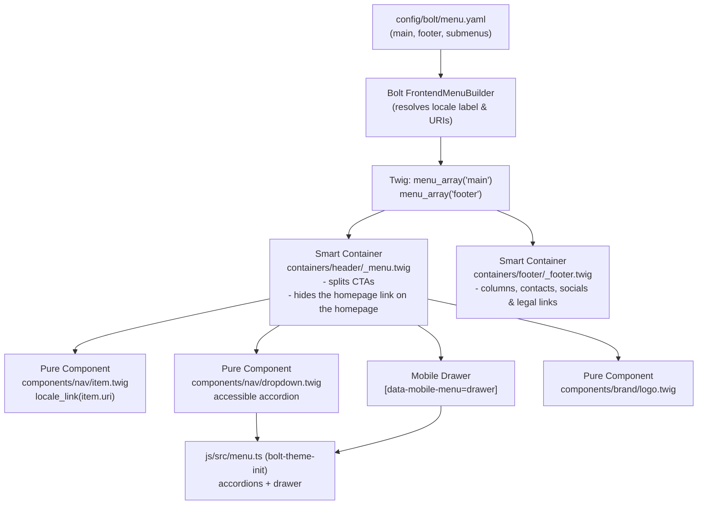

# Bolt CMS Navigation Menus (`bolt-menu`)

This skill defines the architectural rules, configuration standards, and verification runbook for building website navigation in Bolt CMS using `config/bolt/menu.yaml` and consuming it in Twig templates.

---

## Architectural Principles

In Bolt CMS, menus represent the **Information Architecture (IA)** and interface shell of the website. Unlike dynamic editorial content stored in the database, menus live in `config/bolt/menu.yaml` so that navigation remains deterministic, version-controlled in Git, and decoupled from content lifecycles.



### Core Menus Defined in `config/bolt/menu.yaml`
1. **`main`**: The primary top navigation for the header. Contains top-level links, dropdown submenus, and optional Call-to-Action (CTA) items.
2. **`footer`**: Multi-column footer links organized as category headings with child `submenu:` lists.

---

## Critical Rules for `config/bolt/menu.yaml`

### 1. Mandatory Root Slash on Anchors (`/#section`)
> [!IMPORTANT]
> **Never write bare anchor links like `#kontakt` or `#sluzby` in `menu.yaml`.**
> Anchor links **must always** start with a leading slash: `/#kontakt`, `/#o-nas`.

**Why?**
- On the **homepage** (`/`), the browser recognizes the same URL base and smoothly scrolls to `<section id="kontakt">` without reloading.
- On a **subpage or record detail page** (e.g. `/zasady-ochrany-osobnich-udaju`, `/blog/novinka`), a bare `#kontakt` link would attempt to find an anchor on the current subpage, failing completely. A link written as `/#kontakt` cleanly navigates back to the homepage and jumps to `#kontakt`.

### 2. Multilingual Label Parity
When a website supports multiple languages (the codes in `app_locales` in `config/services.yaml`), labels in `menu.yaml` must be declared as a per-locale map containing every code:

```yaml
# Good: Localised dictionary matching configured locales
- label: { cs: 'O nás', en: 'About us', de: 'Über uns' }
  link: /o-nas
```

Bolt's `FrontendMenuBuilder` automatically checks the current request locale (`$twig->getHtmlLang()`), resolves the matching key (falling back to the default locale, then to `title`), and returns the translated string in `item.label`.

### 3. Clean Internal Links Without Locale Prefixes
> [!WARNING]
> **Never hardcode language prefixes in links (`/cs/...` or `/en/...`).**
> Always write the canonical clean path (`/o-nas`, `/kontakt`, `/#sluzby`).

In Twig templates, wrap all URLs in `locale_link(item.uri)` (provided by `bolt-runtime-extensions`). The runtime extension dynamically prepends `/<locale>` when not on the default language while leaving the default language clean.

### 4. Classification & Modifier Flags (`class: cta`, `class: has-submenu`)
Use the `class` attribute in `menu.yaml` as semantic behavioral hooks:
- `class: cta`: Marks an item as a primary Call-to-Action button (e.g. "Rezervovat", "Kontakt").
- `class: has-submenu`: Marks an item having nested dropdown children.

In header Twig templates, split the array using Twig filters:
```twig



```

Classes written in `menu.yaml` are picked up by Tailwind because `css/tailwind/index.css` scans `config/bolt/menu.yaml` (`@source`).

---

## Configuration Recipes

### Recipe A: Anchor-Based Single Page Landing (`menu_landing.yaml`)
Best for single-page service, professional-practice or personal websites, where every section of the homepage is an anchor:

```yaml
# config/bolt/menu.yaml
main:
  - label: { cs: 'Úvod', en: 'Home' }
    link: /
  - label: { cs: 'Služby', en: 'Services' }
    link: /#sluzby
  - label: { cs: 'Jak pracujeme', en: 'How we work' }
    link: /#postup
  - label: { cs: 'Reference', en: 'References' }
    link: /#reference
  - label: { cs: 'Tým', en: 'Team' }
    link: /#tym
  - label: { cs: 'Kontakt', en: 'Contact' }
    link: /#kontakt
    class: cta

# Footer navigation links
footer:
  - label: { cs: 'Navigace', en: 'Navigation' }
    submenu:
      - label: { cs: 'Úvod', en: 'Home' }
        link: /
      - label: { cs: 'Služby', en: 'Services' }
        link: /#sluzby
      - label: { cs: 'Reference', en: 'References' }
        link: /#reference
      - label: { cs: 'Kontakt', en: 'Contact' }
        link: /#kontakt
  - label: { cs: 'Právní informace', en: 'Legal' }
    submenu:
      - label: { cs: 'Zásady ochrany osobních údajů', en: 'Privacy Policy' }
        link: /zasady-ochrany-osobnich-udaju
      - label: { cs: 'Obchodní podmínky', en: 'Terms of Service' }
        link: /obchodni-podminky
```

### Recipe B: Hierarchical Multi-Page Catalog (`menu_catalog.yaml`)
Best for corporate, manufacturing, or e-commerce catalog sites with product groups in a dropdown:

```yaml
# config/bolt/menu.yaml
main:
  - label: { cs: 'O nás', en: 'About us', de: 'Über uns' }
    link: /o-nas
  - label: { cs: 'Produkty', en: 'Products', de: 'Produkte' }
    link: /produkty
    class: has-submenu
    submenu:
      - label: { cs: 'Všechny produkty', en: 'All products', de: 'Alle Produkte' }
        link: /produkty
      - label: { cs: 'Příslušenství', en: 'Accessories', de: 'Zubehör' }
        link: /prislusenstvi
      - label: { cs: 'Náhradní díly', en: 'Spare parts', de: 'Ersatzteile' }
        link: /nahradni-dily
  - label: { cs: 'Služby', en: 'Services', de: 'Leistungen' }
    link: /sluzby
  - label: { cs: 'Reference', en: 'References', de: 'Referenzen' }
    link: /reference
  - label: { cs: 'Kariéra', en: 'Careers', de: 'Karriere' }
    link: /kariera
  - label: { cs: 'Kontakt', en: 'Contact', de: 'Kontakt' }
    link: /kontakt
    class: cta

# --- Footer link columns -----------------------------------------------------
footer:
  - label: { cs: 'Produkty', en: 'Products', de: 'Produkte' }
    submenu:
      - label: { cs: 'Všechny produkty', en: 'All products', de: 'Alle Produkte' }
        link: /produkty
      - label: { cs: 'Příslušenství', en: 'Accessories', de: 'Zubehör' }
        link: /prislusenstvi
      - label: { cs: 'Náhradní díly', en: 'Spare parts', de: 'Ersatzteile' }
        link: /nahradni-dily
      - label: { cs: 'Dokumenty ke stažení', en: 'Downloads', de: 'Downloads' }
        link: /ke-stazeni
  - label: { cs: 'Společnost', en: 'Company', de: 'Unternehmen' }
    submenu:
      - label: { cs: 'O nás', en: 'About us', de: 'Über uns' }
        link: /o-nas
      - label: { cs: 'Reference', en: 'References', de: 'Referenzen' }
        link: /reference
      - label: { cs: 'Kariéra', en: 'Careers', de: 'Karriere' }
        link: /kariera
      - label: { cs: 'Kontakt', en: 'Contact', de: 'Kontakt' }
        link: /kontakt
  - label: { cs: 'Právní informace', en: 'Legal', de: 'Rechtliches' }
    submenu:
      - label: { cs: 'Zásady ochrany osobních údajů', en: 'Privacy Policy', de: 'Datenschutz' }
        link: /zasady-ochrany-osobnich-udaju
```

### Recipe C: Conditional Event / Media Site (`menu_conditional.yaml`)
Best for event, conference or media websites whose homepage sections (programme, performers, tickets) only make sense while their ContentType has published entries. Guard such items in the header template, e.g. `` in the container (inside ``) and skip the `/#ucinkujici` item when `performers` is empty:

```yaml
# config/bolt/menu.yaml
main:
  - label: { cs: 'Úvod', en: 'Home' }
    link: /
  - label: { cs: 'Program', en: 'Programme' }
    link: /#program
  - label: { cs: 'Účinkující', en: 'Performers' }
    link: /#ucinkujici
  - label: { cs: 'Vstupenky', en: 'Tickets' }
    link: /#vstupenky
    class: cta
  - label: { cs: 'O akci', en: 'About the event' }
    link: /#o-akci
  - label: { cs: 'Archiv', en: 'Archive' }
    link: /archiv
  - label: { cs: 'Kontakt', en: 'Contact' }
    link: /#kontakt

footer:
  - label: { cs: 'Akce', en: 'Event' }
    submenu:
      - label: { cs: 'O akci', en: 'About the event' }
        link: /#o-akci
      - label: { cs: 'Program', en: 'Programme' }
        link: /#program
      - label: { cs: 'Účinkující', en: 'Performers' }
        link: /#ucinkujici
      - label: { cs: 'Archiv', en: 'Archive' }
        link: /archiv
  - label: { cs: 'Informace', en: 'Information' }
    submenu:
      - label: { cs: 'Praktické informace a FAQ', en: 'Practical info & FAQ' }
        link: /#faq
      - label: { cs: 'Zásady ochrany osobních údajů', en: 'Privacy Policy' }
        link: /zasady-ochrany-osobnich-udaju
      - label: { cs: 'Kontakt', en: 'Contact' }
        link: /#kontakt
```

The scaffolded recipes are starting points: replace their items with the site's own information architecture.

---

## Twig Integration: Component & Container Architecture

Follow the standard theme architecture from `bolt-theme-init` (Integration Contract in `WORKFLOWS.md`). The master layout `partials/_master.twig` includes `containers/header/_menu.twig` in `` and `containers/footer/_footer.twig` in ``.

### JavaScript Hooks (`js/src/menu.ts` from `bolt-theme-init`)

| Hook | Element | Behaviour |
| :--- | :--- | :--- |
| `[data-sticky-header]` | `<header id="site-header">` | Height subtracted from anchor scroll targets (`auto-scroll.ts`) |
| `[data-dropdown-toggle="<id>"]` → `#<id>.dropdown` | Submenu button and panel (`components/nav/dropdown.twig`) | Accordion: click / ArrowDown opens, Escape / outside click closes, `aria-expanded` and `inert` kept in sync, height animated via `.dropdown` |
| `[data-menu-toggle]` | `#menu-toggle` button; `data-label-open` / `data-label-close` hold the translated `aria-label`s | Opens the drawer |
| `[data-mobile-menu="drawer"]` | `<aside id="mobile-drawer">` (starts `inert`, `aria-hidden="true"`, `translate-x-full`) | Slide-in drawer with focus trap and body scroll lock |
| `[data-menu-backdrop]` | `#menu-backdrop` | Shown with the drawer; a click closes it |
| `[data-menu-close]` | `#menu-close` and the drawer links | Close the drawer (links also close it automatically) |
| `[data-cookie-settings]` | Footer "Nastavení cookies" button | Opens the consent settings, second layer of the banner (`bolt-cookie-consent`) |

For a height-animated panel below the header bar instead of a drawer, use `data-mobile-menu="collapse"` on the panel (see `bolt-theme-init`, section 3D).

### Translation Keys
The containers use these keys; `examples/translations.cs.xlf` and `examples/translations.en.xlf` hold their Czech and English texts. Merge them into every catalog:
```bash
php vendor/vondry/bolt-skills/scripts/merge-xliff.php \
    vendor/vondry/bolt-skills/skills/bolt-menu/examples/translations.cs.xlf translations/messages.cs.xlf
```
`nav.main_label`, `nav.open_menu`, `nav.close_menu`, `nav.mobile_label`, `nav.menu`, `footer.socials`, `footer.rights`, `footer.privacy`, `footer.cookie_settings`.

### 1. Smart Container: `containers/header/_menu.twig`
The smart container retrieves data using `menu_array('main')`, applies business rules (CTA split, homepage-link guard by route `homepage` / `homepage_locale`, active state compared through `locale_link()` so it also works on `/en/…` pages), and renders the header with the desktop navigation and the mobile drawer:

```twig
{# public/theme/<theme>/containers/header/_menu.twig #}
{#
  Smart Container: Header Navigation
  Retrieves menu data via `menu_array('main')` from `config/bolt/menu.yaml`.
  Splits call-to-action buttons from standard nav items, handles active states,
  and delegates rendering to pure components.

  JavaScript hooks (js/src/menu.ts from bolt-theme-init):
    [data-sticky-header]          header height subtracted from anchor scrolling (auto-scroll.ts)
    [data-dropdown-toggle]        submenu accordions (components/nav/dropdown.twig)
    [data-menu-toggle]            opens the mobile drawer
    [data-mobile-menu="drawer"]   the drawer; [data-menu-backdrop] its backdrop
    [data-menu-close]             close button (links inside the drawer close it too)

  Translation keys: nav.main_label, nav.open_menu, nav.close_menu, nav.mobile_label, nav.menu
#}


{# The homepage routes are 'homepage' (/) and 'homepage_locale' (/{_locale}/). #}


{# 1. Retrieve all items for 'main' menu #}


{# 2. Separate CTAs from regular nav links #}



{# 3. Optional guard: drop the homepage link ("Úvod", link: /) when already on the homepage #}


<header id="site-header" data-sticky-header class="sticky top-0 z-40 bg-canvas/95 backdrop-blur-md border-b border-stroke">
    <div class="wrapper px-edge flex items-center justify-between h-header gap-6">

        {# Logo #}
        <a href="{{ locale_link('/') }}" class="flex items-center shrink-0" aria-label="{{ config.get('general/sitename') }}">
            
        </a>

        {# Desktop Navigation #}
        <nav class="hidden menu:flex items-center" aria-label="{{ __('nav.main_label') }}">
            <ul class="flex items-center gap-1 list-none m-0 p-0">
                
                    {# Compare the locale-prefixed URL with the request path, so items are also
                       active on /en/… pages; anchors (/#section) are never "active". #}
                    
                    

                    
                        
                        
                    
                        <li>
                            
                        </li>
                    
                
            </ul>
        </nav>

        {# Desktop Action Area (Locale Switcher + CTA buttons) #}
        <div class="hidden menu:flex items-center gap-4">
            

            
                
            
        </div>

        {# Mobile Menu Button #}
        <button id="menu-toggle"
                type="button"
                data-menu-toggle
                aria-expanded="false"
                aria-controls="mobile-drawer"
                aria-label="{{ __('nav.open_menu') }}"
                data-label-open="{{ __('nav.open_menu') }}"
                data-label-close="{{ __('nav.close_menu') }}"
                class="menu:hidden p-2 text-ink hover:text-accent focus-visible:outline-none focus-visible:ring-2 focus-visible:ring-accent rounded-sm">
            <svg viewBox="0 0 24 24" fill="none" stroke="currentColor" stroke-width="2" class="size-6 shrink-0" aria-hidden="true">
                <path stroke-linecap="round" stroke-linejoin="round" d="M4 6h16M4 12h16M4 18h16"/>
            </svg>
        </button>
    </div>
</header>

{# Mobile Backdrop & Drawer — hidden from assistive tech until menu.ts opens it #}
<div id="menu-backdrop"
     data-menu-backdrop
     class="fixed inset-0 bg-night/50 z-40 opacity-0 pointer-events-none transition-opacity duration-300 menu:hidden"
     aria-hidden="true"></div>

<aside id="mobile-drawer"
       data-mobile-menu="drawer"
       aria-label="{{ __('nav.mobile_label') }}"
       aria-hidden="true"
       inert
       class="fixed top-0 right-0 h-full w-80 max-w-[85vw] bg-canvas z-50 flex flex-col translate-x-full transition-transform duration-300 ease-out shadow-2xl menu:hidden">
    <div class="flex items-center justify-between p-4 border-b border-stroke">
        <span class="font-bold text-lg text-ink">{{ __('nav.menu') }}</span>
        <button id="menu-close"
                type="button"
                data-menu-close
                aria-label="{{ __('nav.close_menu') }}"
                class="p-2 text-ink-2 hover:text-ink rounded-sm">
            <svg viewBox="0 0 24 24" fill="none" stroke="currentColor" stroke-width="2" class="size-6" aria-hidden="true">
                <path stroke-linecap="round" stroke-linejoin="round" d="M6 18L18 6M6 6l12 12"/>
            </svg>
        </button>
    </div>

    <nav class="flex-1 overflow-y-auto p-4 flex flex-col gap-2" aria-label="{{ __('nav.main_label') }}">
        
            
                <div class="flex flex-col gap-1 py-1">
                    <span class="font-semibold text-xs uppercase tracking-wider text-ink-3 px-3">{{ item.label }}</span>
                    
                        <a href="{{ locale_link(sub.uri|default(sub.link)) }}"
                           data-menu-close
                           class="px-4 py-2 text-base text-ink hover:text-accent hover:bg-surface rounded-sm transition-colors">
                            {{ sub.label }}
                        </a>
                    
                </div>
            
                <a href="{{ locale_link(item.uri|default(item.link)) }}"
                   data-menu-close
                   class="px-3 py-2 text-base font-medium text-ink hover:text-accent hover:bg-surface rounded-sm transition-colors">
                    {{ item.label }}
                </a>
            
        

        
            <div class="pt-4 mt-2 border-t border-stroke flex flex-col gap-3">
                
                    <a href="{{ locale_link(cta.uri|default(cta.link)) }}"
                       data-menu-close
                       class="btn-primary text-center">
                        {{ cta.label }}
                    </a>
                
            </div>
        

        <div class="mt-auto pt-6 border-t border-stroke">
            
        </div>
    </nav>
</aside>
```

### 2. Pure Component: `components/nav/item.twig`
Pure presentational component with zero database calls:

```twig
{# public/theme/<theme>/components/nav/item.twig #}
{#
  Pure Component: Navigation Link Item
  Props:
    - label (string): Display text
    - uri (string): Target link (passed to locale_link)
    - class (string|optional): Extra CSS classes
    - is_active (bool|optional): Whether item is currently active (adds aria-current="page")
    - is_cta (bool|optional): Render as the primary call-to-action button (.btn-primary)
#}



    <a href="{{ target_url }}"
       class="btn-primary {{ class|default('') }}">
        {{ label }}
    </a>

    <a href="{{ target_url }}"
       class="inline-flex items-center gap-1 px-3 py-2 font-medium text-base transition-colors duration-200 {{ is_active|default(false) ? 'text-accent font-semibold' : 'text-ink hover:text-accent' }} {{ class|default('') }}"
       aria-current="page">
        {{ label }}
    </a>

```

### 3. Pure Component: `components/nav/dropdown.twig`
Accessible dropdown driven by the accordion in `menu.ts`:

```twig
{# public/theme/<theme>/components/nav/dropdown.twig #}
{#
  Pure Component: Accessible Navigation Dropdown
  Behaviour comes from js/src/menu.ts (bolt-theme-init): click or ArrowDown opens the
  panel, Escape or a click outside closes it, `aria-expanded` and `inert` stay in sync.
  The panel uses `.dropdown` (overflow: hidden; height: 0; height transition) from the
  Tailwind source; padding and borders sit on the inner element so the height animates.

  Props:
    - id (string): Unique identifier for the panel (aria-controls / data-dropdown-toggle)
    - label (string): Trigger button text
    - submenu (array): List of items with { label, uri, link }
    - is_active (bool|optional): Whether the parent or any child item is active
#}


<li class="relative">
    <button type="button"
            data-dropdown-toggle="{{ dd_id }}"
            aria-expanded="false"
            aria-controls="{{ dd_id }}"
            class="inline-flex items-center gap-1.5 px-3 py-2 font-medium text-base cursor-pointer transition-colors duration-200 {{ is_active|default(false) ? 'text-accent font-semibold' : 'text-ink hover:text-accent' }}">
        <span>{{ label }}</span>
        <svg viewBox="0 0 24 24" class="rotate-svg size-4 shrink-0" fill="none" stroke="currentColor" stroke-width="2" aria-hidden="true">
            <path stroke-linecap="round" stroke-linejoin="round" d="m6 9 6 6 6-6"/>
        </svg>
    </button>

    <div id="{{ dd_id }}" class="dropdown absolute top-full left-0 min-w-52 z-50" inert>
        <ul class="mt-2 flex flex-col list-none py-2 bg-canvas border border-stroke shadow-xl rounded-sm">
            
                <li>
                    <a href="{{ locale_link(sub.uri|default(sub.link)) }}"
                       class="block px-4 py-2.5 text-sm font-normal text-ink-2 hover:text-accent hover:bg-surface transition-colors">
                        {{ sub.label }}
                    </a>
                </li>
            
        </ul>
    </div>
</li>
```

### 4. Smart Container: `containers/footer/_footer.twig`
Footer columns from `menu_array('footer')`, brand column with logo, bio, phone and e-mail, social links and the legal bottom bar. Uses the dark `night` palette of `bolt-tailwind-theme`:

```twig
{# public/theme/<theme>/containers/footer/_footer.twig #}
{#
  Smart Container: Footer Navigation & Columns
  Retrieves menu columns via `menu_array('footer')` from `config/bolt/menu.yaml`
  (top-level items are column headings, their `submenu:` lists are the links).
  Renders the brand column (logo, bio, phone, e-mail from theme.yaml), social links
  from theme.yaml, and the legal bottom bar.

  "Nastavení cookies" opens the consent settings (bolt-cookie-consent listens to
  [data-cookie-settings]); it is shown whenever theme.yaml privacy.cookies lists an item
  that needs consent (trackers, embeds) — the same rule that renders the banner.

  Translation keys: footer.socials, footer.rights, footer.privacy, footer.cookie_settings
#}



{# Cookie inventory from theme.yaml (bolt-cookie-consent): anything beyond `necessary` needs consent. #}


<footer class="bg-night text-night-ink-2 border-t border-night-stroke">
    <div class="wrapper px-edge py-16 flex flex-col gap-12">

        {# Top section: Brand / Bio + Link Columns #}
        <div class="flex flex-col lg:flex-row items-start justify-between gap-12">

            {# Brand summary column #}
            <div class="flex flex-col gap-4 max-w-sm">
                
                <p class="text-sm leading-relaxed">
                    {{ config.get('theme/contact/bio')|default(config.get('general/payoff')|default('')) }}
                </p>

                {# Contact quick info #}
                <div class="flex flex-col gap-1 text-sm">
                    
                        <a href="tel:{{ config.get('theme/contact/phone')|replace({' ': ''}) }}" class="hover:text-night-ink transition-colors">
                            {{ config.get('theme/contact/phone') }}
                        </a>
                    
                    
                        <a href="mailto:{{ config.get('theme/contact/email') }}" class="hover:text-night-ink transition-colors">
                            {{ config.get('theme/contact/email') }}
                        </a>
                    
                </div>

                {# Social links from theme.yaml (socials: { facebook: url, … }) #}
                
                    <ul class="flex flex-wrap items-center gap-4 pt-2" aria-label="{{ __('footer.socials') }}">
                        
                            <li>
                                <a href="{{ url }}"
                                   target="_blank"
                                   rel="noopener noreferrer"
                                   class="text-xs uppercase tracking-wider hover:text-night-ink transition-colors">
                                    {{ network }}
                                </a>
                            </li>
                        
                    </ul>
                
            </div>

            {# Footer Navigation Columns #}
            <div class="flex flex-wrap gap-10 sm:gap-16">
                
                    <div class="flex flex-col gap-4 min-w-35">
                        <h3 class="font-semibold text-sm uppercase tracking-wider text-night-ink">
                            {{ column.label }}
                        </h3>
                        <ul class="flex flex-col gap-2.5 list-none m-0 p-0 text-sm">
                            
                                <li>
                                    <a href="{{ locale_link(item.uri|default(item.link)) }}"
                                       class="hover:text-night-ink transition-colors">
                                        {{ item.label }}
                                    </a>
                                </li>
                            
                        </ul>
                    </div>
                
            </div>
        </div>

        {# Bottom Bar: Copyright & Legal links #}
        <div class="pt-8 border-t border-night-stroke flex flex-col sm:flex-row items-center justify-between gap-4 text-xs text-night-ink-3">
            <p>© {{ 'now'|date('Y') }} {{ config.get('general/sitename') }}. {{ __('footer.rights') }}</p>

            <ul class="flex flex-wrap items-center gap-6 list-none m-0 p-0">
                <li>
                    <a href="{{ locale_link('/zasady-ochrany-osobnich-udaju') }}" class="hover:text-night-ink transition-colors">
                        {{ __('footer.privacy') }}
                    </a>
                </li>
                
                    <li>
                        <button type="button" data-cookie-settings class="hover:text-night-ink transition-colors cursor-pointer">
                            {{ __('footer.cookie_settings') }}
                        </button>
                    </li>
                
            </ul>
        </div>
    </div>
</footer>
```

### 5. Pure Component: `components/brand/logo.twig`
Logo image from `theme.yaml` (`logo.default`, `logo.light` for dark backgrounds), or the site name as text when no logo is configured:

```twig
{# public/theme/<theme>/components/brand/logo.twig #}
{#
  Pure Component: Brand Logo
  Renders the logo image configured in theme.yaml, or the site name as text when no
  logo is configured (useful right after scaffolding).

    # theme.yaml
    logo:
      default: 'img/logo/logo.svg'        # relative to the theme folder
      light: 'img/logo/logo-light.svg'    # variant for dark backgrounds (footer, hero)

  Props:
    - class (string|optional): Classes for the  / text (e.g. 'h-8 w-auto')
    - tone (string|optional): 'dark' (default, for light backgrounds) | 'light'
    - alt (string|optional): Alternative text (default: general/sitename). Pass alt: ''
        when the surrounding link already carries an aria-label.
#}




    

    <span class="font-display text-lg font-semibold tracking-tight {{ class|default('') }}">{{ sitename }}</span>

```

---

## Automation Scripts

### Scaffolding Script (`scripts/scaffold.sh`)
Scaffolds `config/bolt/menu.yaml` based on project archetypes:

```bash
# Auto-detect profile from ContentTypes:
bash skills/bolt-menu/scripts/scaffold.sh

# Force specific profile:
bash skills/bolt-menu/scripts/scaffold.sh --profile=landing --force
bash skills/bolt-menu/scripts/scaffold.sh --profile=catalog --force
bash skills/bolt-menu/scripts/scaffold.sh --profile=conditional --force

# Also copy Twig container and component templates into the active theme
# (header, footer, nav item, nav dropdown, brand logo; existing files are kept):
bash skills/bolt-menu/scripts/scaffold.sh --profile=catalog --templates --force
```

> [!NOTE]
> `bolt/project` ships a sample `config/bolt/menu.yaml`. Without `--force` the script stops at "already exists" **before** copying the templates, so pass `--force` on a new project (the written menu is a placeholder to be replaced with the site's IA).

### Verification Script (`scripts/verify.sh`)
Runs automated validation against Bolt CMS menu requirements:

```bash
bash skills/bolt-menu/scripts/verify.sh
```

**Checks Performed:**
1. Verifies `config/bolt/menu.yaml` exists.
2. Validates YAML syntax via `bin/console lint:yaml` and `Symfony\Component\Yaml\Yaml::parseFile`.
3. Validates mandatory `main:` menu and nested schema.
4. Checks multilingual parity: warns if a locale from `app_locales` in `config/services.yaml` is missing in a `label:` map (falls back to `locales:` in `config/bolt/config.yaml` on older projects).
5. Checks anchor formatting: errors on bare `#section` and enforces `/#section`.
6. Checks clean paths: warns if a link starts with a hardcoded prefix of one of the configured locales (`/cs/`, `/en/`, …).
7. Theme integration check: verifies `menu_array('main')` is called in the active theme.
8. Verifies all menu URLs are wrapped in `locale_link(...)`.

---

## Common Pitfalls & Solutions

| Pitfall | Symptoms | Fix |
| :--- | :--- | :--- |
| **Bare `#anchor` in `menu.yaml`** | Anchor links fail when user visits from subpages (e.g. privacy policy). | Always use leading slash: `/#kontakt` instead of `#kontakt`. |
| **Hardcoded `/en/` or `/cs/` in `link`** | Language switcher produces double prefixes (e.g. `/en/en/contact`) or breaks on default locale. | Write clean canonical paths (`/contact`). Twig's `locale_link(item.uri)` handles the prefix. |
| **Missing translation in `label` dict** | Menu item falls back to title or renders empty string in secondary locale. | Ensure every configured locale has a key: `{ cs: '...', en: '...' }`. |
| **Homepage link (`/`) shown on homepage** | Redundant "Úvod" link clutters the navbar next to the logo. | Detect the homepage by route (`app.request.attributes.get('_route') in ['homepage', 'homepage_locale']`) and filter: `nav_items\|filter(i => not (on_homepage and i.link == '/'))`. |
| **Active state compared with the unprefixed URI** | Items are never highlighted on `/en/…` pages. | Compare `locale_link(item.uri)` with `app.request.pathinfo`. |
| **`hidden group-hover:block` / `focus-within:block` on the dropdown panel** | Keyboard users cannot open the submenu (a hidden panel cannot receive focus) and `aria-expanded` never changes. | `.dropdown` panel + `data-dropdown-toggle` button driven by `menu.ts`. |
| **Drawer markup without the `data-*` hooks** | The mobile menu button does nothing. | `data-menu-toggle`, `data-mobile-menu="drawer"`, `data-menu-backdrop`, `data-menu-close` as in the header container. |
| **Colour names outside the token set** (`brand`, `ink-800`) | Undefined names generate no CSS; the header renders unstyled. | Use the tokens of `bolt-tailwind-theme` (`ink`, `ink-2`, `accent`, `surface`, `stroke`, `night*`). |
| **Using deprecated `{{ menu() }}`** | Unstyled default HTML markup from Bolt core overrides custom Tailwind classes. | Always use `menu_array('main')` and iterate using your own components. |
