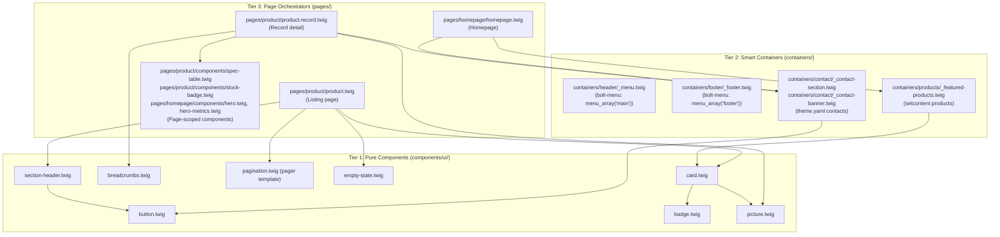

# Bolt CMS Theme Templates (`bolt-theme-templates`)

This skill establishes the production implementation standards, folder organization, and automated verification runbook for building Twig templates with Tailwind CSS v4 in Bolt CMS. It follows the **Integration Contract** in `WORKFLOWS.md`: every page extends `partials/_master.twig` (created by `bolt-theme-init`) and fills ``; classes use the design tokens of `bolt-tailwind-theme`; links go through `locale_link()`; visible strings are translation keys.

---

## 1. Architectural Principles: Component / Container / Page

Bolt CMS themes in this repository follow a strict three-tier architecture:



---

### Tier 1: Pure Presentational Components (`components/`)
* **Strict Rule: ZERO `setcontent`**: Pure components **never** query the database, invoke `setcontent`, or read global request state directly.
* **Pure Props Interface**: All data must be passed in via arguments/parameters (`{ title, href, image, class, ... }`).
* **Composability**: Pure components can reuse and compose other pure components (e.g. `card.twig` composes `picture.twig` and `badge.twig`).
* **Deterministic & Reusable**: Can be rendered in any context, storybook, or test harness without requiring database fixtures.

### Tier 2: Smart Data Containers (`containers/`)
* **Data Retrieval**: Reusable sections that query data via ``, `menu_array()`, or settings from `theme.yaml` (`config.get('theme/...')`).
* **Section Encapsulation**: Designed as reusable blocks across multiple pages (e.g. `containers/header/_menu.twig`, `containers/footer/_footer.twig`, `containers/contact/_contact-section.twig`, `containers/products/_featured-products.twig`, `containers/gallery/_grid.twig`).
* **Delegation**: Containers handle data fetching and layout structure, delegating individual element rendering down to pure components.
* **Extensibility**: Containers can wrap slots or extend other containers.

### Tier 3: Page Orchestrators (`pages/`)
* **ContentType Binding**: Linked directly to Bolt ContentTypes or static routes:
  - Listing page: `pages/<contenttype>/<contenttype>.twig` (e.g. `pages/product/product.twig`)
  - Single record detail: `pages/<contenttype>/<contenttype>.record.twig` (e.g. `pages/product/product.record.twig`)
  - Homepage: `pages/homepage/homepage.twig` (bound by the root `index.twig`)
  - Bind with `listing_template` / `record_template` in `contenttypes.yaml`, either directly (`pages/product/product.twig`) or through a one-line root entrypoint (`product.twig` → ``).
* **Layout**: Every page `` and fills `` (overriding `` / `` only when needed).
* **Strict Rule: ZERO Raw HTML (or near-zero)**: Pages should not write extensive raw HTML markup. A page template's sole responsibility is orchestrating containers and pure components, mapping record fields, and passing data down. Layout wrappers (`wrapper px-edge`, a grid `<ul>`) are acceptable; anything reusable moves to a component; any query moves to a container.
* **Page-Scoped Components**: When a component is unique to a single page and never used elsewhere (e.g. `pages/product/components/spec-table.twig` or `pages/homepage/components/hero.twig`), it lives in a `components/` subfolder inside that page folder.

---

## 2. Directory Structure of a Compliant Theme

```text
public/theme/<theme_name>/
├── components/                       # Tier 1: Pure presentational components
│   ├── brand/
│   │   └── logo.twig                 # bolt-menu
│   ├── nav/                          # bolt-menu: item.twig, dropdown.twig
│   └── ui/                           # this skill
│       ├── badge.twig
│       ├── breadcrumbs.twig
│       ├── button.twig
│       ├── card.twig
│       ├── empty-state.twig
│       ├── pagination.twig           # template for Bolt's pager()
│       ├── picture.twig
│       └── section-header.twig
├── containers/                       # Tier 2: Smart layout containers
│   ├── contact/
│   │   ├── _contact-banner.twig      # compact CTA banner
│   │   └── _contact-section.twig     # full contact section (#kontakt)
│   ├── footer/
│   │   └── _footer.twig              # bolt-menu
│   ├── header/
│   │   └── _menu.twig                # bolt-menu
│   └── products/
│       └── _featured-products.twig   # catalog sites
├── pages/                            # Tier 3: Page orchestrators
│   ├── homepage/
│   │   ├── components/
│   │   │   ├── hero.twig             # Page-scoped component
│   │   │   └── hero-metrics.twig     # Page-scoped component
│   │   └── homepage.twig
│   ├── product/                      # catalog sites
│   │   ├── components/
│   │   │   ├── spec-table.twig       # Page-scoped component
│   │   │   └── stock-badge.twig      # Page-scoped component
│   │   ├── product.record.twig       # Record detail orchestrator
│   │   └── product.twig              # Listing orchestrator
│   └── search/                       # every site: Bolt serves /search and /{_locale}/search
│       ├── components/
│       │   ├── search-form.twig      # Page-scoped component (submits to the current locale)
│       │   └── search-result.twig    # Page-scoped component
│       └── search.twig               # Search results orchestrator (root search.twig extends it)
├── partials/                         # Layout shell and shared partials
│   ├── _master.twig                  # bolt-theme-init: blocks seo, head, header, main, footer, scripts
│   ├── _cookie-banner.twig           # bolt-cookie-consent
│   ├── _consent-mode.twig            # bolt-cookie-consent
│   └── _locale-switcher.twig         # bolt-add-language
├── helper-pages/                     # bolt-helper-pages (404/403/500/503)
├── static-pages/                     # pages served by TemplateController routes
├── css/
│   ├── tailwind/
│   │   └── index.css                 # Tailwind v4 source (@source, @theme inline tokens, utilities)
│   └── index.css                     # build output (never edit)
└── js/
    └── src/                          # TypeScript modules (Rollup bundle → js/app.js)
```

---

## 3. Implementation Blueprint & Examples

All examples use the token names of `bolt-tailwind-theme` (`canvas`, `surface`, `surface-2`, `ink`, `ink-2`, `ink-3`, `stroke`, `accent*`, `night*`, text sizes `hero` / `section` / `card` / `lead` / `body` / `meta` / `micro`) and its utilities (`wrapper`, `px-edge`, `py-section`, `card`, `eyebrow`, `link-arrow`, `pagination`, `cms-redactor`). Status colours (`emerald`, `amber` in the badge and stock badge) are Tailwind defaults used on purpose.

### A. Pure Button Component (`components/ui/button.twig`)
```twig
{#
  Pure Component: UI Button
  Rules: Zero setcontent. Purely presentational.

  Props:
    - label (string): Button label text
    - href (string|optional): If provided, renders an <a> link, else <button>.
        Internal paths go through locale_link(); external URLs (http://, https://, //)
        open in a new tab with rel="noopener noreferrer"; tel:/mailto: stay as they are.
    - variant (string|optional): 'primary' | 'secondary' | 'dark' | 'outline' | 'light-outline' | 'ghost' (default: 'primary')
        'light-outline' is the outline variant for dark backgrounds (hero, night bands).
    - size (string|optional): 'sm' | 'md' | 'lg' (default: 'md')
    - icon (string|optional): Raw SVG from the theme. Printed unescaped — trusted theme markup only, never CMS or translation text
    - icon_position (string|optional): 'left' | 'right' (default: 'right')
    - type (string|optional): 'button' | 'submit' (default: 'button')
    - class (string|optional): Additional Tailwind classes
    - disabled (bool|optional): Disabled state
    - aria_label (string|optional): Accessibility label

  Classes come from the design tokens of bolt-tailwind-theme (accent, ink, surface, stroke,
  night). Variant and size maps hold full static class strings so Tailwind can scan them.
#}



{% set variant_map = {
    'primary':       'bg-accent hover:bg-accent-hover text-accent-ink shadow-sm focus-visible:outline-accent',
    'secondary':     'bg-surface hover:bg-surface-2 text-ink border border-stroke focus-visible:outline-ink',
    'dark':          'bg-night hover:bg-night-deep text-night-ink shadow-sm focus-visible:outline-night',
    'outline':       'bg-transparent border border-stroke hover:border-ink text-ink focus-visible:outline-ink',
    'light-outline': 'bg-transparent border border-night-ink/30 hover:border-night-ink hover:bg-night-ink/10 text-night-ink focus-visible:outline-night-ink',
    'ghost':         'bg-transparent hover:bg-surface text-ink-2 hover:text-ink focus-visible:outline-ink'
} %}








    
    <a href="{{ is_external ? href : locale_link(href) }}"
       class="{{ full_classes }}"
       target="_blank" rel="noopener noreferrer"
       aria-label="{{ aria_label }}">
        {{ icon|raw }}
        <span>{{ label }}</span>
        {{ icon|raw }}
    </a>

    <button type="{{ type|default('button') }}"
            class="{{ full_classes }}"
            disabled
            aria-label="{{ aria_label }}">
        {{ icon|raw }}
        <span>{{ label }}</span>
        {{ icon|raw }}
    </button>

```

### B. Pure Card Component (`components/ui/card.twig`)
The stretched link (`absolute inset-0` on the title link) makes the whole card clickable; `relative` on `<article>` keeps the overlay inside the card.
```twig
{#
  Pure Component: UI Card (Product / Blog / Service / Reference item)
  Rules: Zero setcontent. Composes pure components (picture, badge).

  Props:
    - title (string): Card headline
    - href (string): Link target (passed through locale_link)
    - image (Bolt image field|string|optional): Card image
    - badge (string|optional): Category or status text, rendered with components/ui/badge.twig
    - badge_markup (string|optional): Pre-rendered badge from a theme template (printed unescaped —
        pass include() output only, never CMS or translation text), e.g. a page-scoped component:
        badge_markup: include('pages/product/components/stock-badge.twig', { stock: item.stock })
    - description (string|optional): Excerpt / summary (HTML is stripped)
    - price (string|optional): Pre-formatted price, e.g. macros.formatPrice(item.price)
    - edit_url (string|optional): Bolt admin edit URL (item|edit_link — empty for visitors)
    - class (string|optional): Extra wrapper classes

  The whole card is clickable through a stretched link on the title: the overlay
  (`absolute inset-0`) needs the `relative` on <article> to stay inside the card.

  Translation keys: card.read_more, card.edit
#}


<article class="card relative flex flex-col group overflow-hidden {{ class|default('') }}">
    {# Admin quick edit button (above the stretched link) #}
    
        <div class="absolute top-3 right-3 z-20">
            <a href="{{ edit_url }}"
               class="inline-flex items-center px-2 py-0.5 text-xs font-semibold text-ink bg-surface rounded-sm border border-stroke hover:bg-surface-2 shadow-xs">
                ✏️ {{ __('card.edit') }}
            </a>
        </div>
    

    
        <div class="relative overflow-hidden aspect-16/10 bg-surface">
            
        </div>
    

    
        <div class="absolute top-3 left-3 z-10">
            
                {{ badge_markup|raw }}
            
                
            
        </div>
    

    <div class="flex-1 p-6 flex flex-col justify-between gap-4">
        <div class="flex flex-col gap-2">
            <h3 class="font-display text-card font-semibold text-ink group-hover:text-accent transition-colors">
                <a href="{{ locale_link(href) }}" class="focus:outline-none">
                    <span class="absolute inset-0" aria-hidden="true"></span>
                    {{ macros.typo(title) }}
                </a>
            </h3>

            
                <p class="text-body text-ink-2 line-clamp-3 leading-relaxed">
                    {{ description|striptags }}
                </p>
            
        </div>

        <div class="pt-2 flex items-center justify-between text-sm font-semibold">
            
                <span class="text-base font-bold text-accent">{{ price }}</span>
            
            <span class="link-arrow">
                {{ __('card.read_more') }}
                <svg viewBox="0 0 24 24" class="size-4" fill="none" stroke="currentColor" stroke-width="2" aria-hidden="true">
                    <path stroke-linecap="round" stroke-linejoin="round" d="M5 12h14m-6-6 6 6-6 6"/>
                </svg>
            </span>
        </div>
    </div>
</article>
```

### C. Pure Picture Component (`components/ui/picture.twig`)
Dimensions come from the media library first (`image|media`), then from `image_dimensions()` (`bolt-runtime-extensions`) for images without a media entry. With `pswp: true` the picture is rendered as a PhotoSwipe slide link (`a.photoswipe-gallery__link` with `data-pswp-width` / `data-pswp-height`) — wrap the pictures of one gallery in `<div class="photoswipe-gallery">` (`js/src/photoswipe.ts`).

Every photo gallery opens in this lightbox, also when the design shows none (a static design has no click state). The gallery container carries the lightbox's UI labels from the translation catalog — PhotoSwipe's own are English: `data-pswp-close-title="{{ __('gallery.close') }}"`, `data-pswp-zoom-title` (`gallery.zoom`), `data-pswp-arrow-prev-title` (`gallery.previous`), `data-pswp-arrow-next-title` (`gallery.next`), `data-pswp-error-msg` (`gallery.error`). Put the alt text in a hidden `.photoswipe-gallery__caption` inside the link to show it as the lightbox caption; a link whose image has no alt gets `aria-label="{{ __('gallery.open_photo', { '%index%': loop.index }) }}"`. Galleries with their own tile layout (2×2 first tile, fixed row heights) keep the same contract on their own `<a>` tiles instead of `picture.twig`.
```twig
{#
  Pure Component: Responsive Picture / Image
  Rules: Zero setcontent. Purely presentational.

  Props:
    - image (Bolt image field|string): Pass the image field (record.image); a string is
        treated as a filename / public URL
    - alt (string|optional): Image alternative text (default: the field's alt or title)
    - width (int|optional): Intrinsic width
    - height (int|optional): Intrinsic height
    - loading (string|optional): 'lazy' | 'eager' (default: 'lazy')
    - class (string|optional): CSS classes for the  element
    - aspect (string|optional): Aspect ratio class e.g. 'aspect-16/9', 'aspect-4/3', 'aspect-square'
    - sizes (string|optional): the `sizes` attribute — how wide the image is shown. Default fits a
        three-column grid; a full-width hero needs '100vw'
    - pswp (bool|optional): Render the picture as a PhotoSwipe 5 slide link. Wrap the
        pictures of one gallery in <div class="photoswipe-gallery"> (js/src/photoswipe.ts).

  Intrinsic dimensions (needed by PhotoSwipe and for layout stability):
    1. width/height props, if given;
    2. the media library entry (image|media — a database read, no disk access);
    3. image_dimensions() from bolt-runtime-extensions — only for images without a media
       entry (static theme assets, filenames set without picking from the library).
#}







    
    
        
        
    
        
        
        
    



    


<picture class="block overflow-hidden {{ aspect|default('') }}">
    
        <a href="{{ img_url }}"
           class="photoswipe-gallery__link block w-full h-full"
           data-pswp-width="{{ img_width }}"
           data-pswp-height="{{ img_height }}">
            {{ img_tag }}
        </a>
    
        {{ img_tag }}
    
</picture>
```

### D. Pagination for Bolt's `pager()` (`components/ui/pagination.twig`)
Bolt 6 listings receive `records` as a Pagerfanta object (`haveToPaginate`, `currentPage`, `nbPages`, `hasPreviousPage`, `previousPage`, …). Bolt's `pager()` function renders a template with `records`, `route`, `routeParams`, `surround` and `class`; this component is such a template:
```twig
{{ pager(records, template = 'components/ui/pagination.twig') }}
```
```twig
{#
  Pure Component: Accessible Pagination — a template for Bolt's pager() function.

  Usage (records is the Pagerfanta object Bolt passes to listing templates):
    {{ pager(records, template = 'components/ui/pagination.twig') }}

  pager() provides: records, route, routeParams, surround (default 3), class ('pagination'),
  previous_link_class, next_link_class. Links keep the current route, its parameters
  (including _locale) and the query string, and only change `page`.

  Styling: the `.pagination` rules from bolt-tailwind-theme (li a, li.active a,
  a[aria-current], li.disabled > span).

  Translation keys: a11y.pagination, pager.previous, pager.next
#}


    
    
    
    

    <nav aria-label="{{ __('a11y.pagination') }}" class="my-12">
        <ul class="{{ class|default('pagination') }}">
            
                <li class="{{ previous_link_class|default('previous') }}">
                    <a href="{{ path(route, routeParams|merge({ page: records.previousPage })) }}" rel="prev" aria-label="{{ __('pager.previous') }}">
                        <svg viewBox="0 0 24 24" class="size-4" fill="none" stroke="currentColor" stroke-width="2" aria-hidden="true">
                            <path stroke-linecap="round" stroke-linejoin="round" d="M15 19l-7-7 7-7"/>
                        </svg>
                    </a>
                </li>
            

            
                <li><a href="{{ path(route, routeParams|merge({ page: 1 })) }}">1</a></li>
                
                    <li class="disabled" aria-hidden="true"><span>…</span></li>
                
            

            
                <li class="active">
                    <a href="{{ path(route, routeParams|merge({ page: page })) }}" aria-current="page">{{ page }}</a>
                </li>
            

            
                
                    <li class="disabled" aria-hidden="true"><span>…</span></li>
                
                <li><a href="{{ path(route, routeParams|merge({ page: last })) }}">{{ last }}</a></li>
            

            
                <li class="{{ next_link_class|default('next') }}">
                    <a href="{{ path(route, routeParams|merge({ page: records.nextPage })) }}" rel="next" aria-label="{{ __('pager.next') }}">
                        <svg viewBox="0 0 24 24" class="size-4" fill="none" stroke="currentColor" stroke-width="2" aria-hidden="true">
                            <path stroke-linecap="round" stroke-linejoin="round" d="M9 5l7 7-7 7"/>
                        </svg>
                    </a>
                </li>
            
        </ul>
    </nav>

```

### E. Pure Section Header (`components/ui/section-header.twig`)
```twig
{#
  Pure Component: Section Header (eyebrow, heading, lead, optional link)
  Rules: Zero setcontent. All data passed via parameters.
  Wire it to its section with aria-labelledby="{{ title_id }}".

  Props:
    - title (string): Section heading
    - title_id (string|optional): HTML id of the heading, for aria-labelledby on the section
    - eyebrow (string|optional): Small kicker label above the heading
    - lead (string|optional): Intro paragraph; may contain HTML (a translation or CMS field) — it is
        cleaned by Bolt's HTML cleaner (|sanitise) before output
    - layout (string|optional): 'stacked' (default) | 'split' | 'center'
    - link (object|optional): { label, href } — rendered as a secondary button ('split' layout)
    - heading_level (int|optional): 2 (default) or 1 for page titles
    - class (string|optional)

  Translation keys: section.show_all (default label of the link)
#}






    
        <p class="eyebrow mb-2">{{ eyebrow }}</p>
    
    <{{ tag }} id="{{ title_id }}"
        class="font-display text-section font-semibold tracking-tight text-ink">
        {{ macros.typo(title) }}
    </{{ tag }}>
    
        <p class="mt-3 text-lead text-ink-2">{{ lead|sanitise|raw }}</p>
    



    <div class="max-w-3xl mx-auto text-center mb-10 {{ class|default('') }}">
        {{ heading }}
    </div>


    <div class="flex flex-col md:flex-row md:items-end md:justify-between gap-6 mb-10 {{ class|default('') }}">
        <div class="max-w-2xl">
            {{ heading }}
        </div>
        
            <div class="shrink-0">
                
            </div>
        
    </div>


    {# stacked (default) #}
    <div class="max-w-2xl mb-8 {{ class|default('') }}">
        {{ heading }}
    </div>

```

### F. Badge, Breadcrumbs, Empty State
```twig
{#
  Pure Component: UI Badge / Chip
  Rules: Zero setcontent. Purely presentational.

  Props:
    - label (string): Badge text
    - variant (string|optional): 'accent' | 'neutral' | 'success' | 'warning' (default: 'accent')
        'brand' and 'ink' are accepted as aliases of 'accent' and 'neutral'.
        'success' / 'warning' use Tailwind's emerald / amber on purpose (status colours
        are not part of the brand palette).
    - size (string|optional): 'sm' | 'md' (default: 'md')
    - class (string|optional): Additional classes
#}









<span class="inline-flex items-center justify-center rounded-full leading-none {{ variant_styles }} {{ size_styles }} {{ class|default('') }}">
    {{ label }}
</span>
```
```twig
{#
  Pure Component: Accessible Breadcrumbs (schema.org BreadcrumbList)
  Rules: Zero setcontent.

  Props:
    - items (array): List of { label, href (optional) }; the last item is the current page
    - class (string|optional): Extra classes

  Translation keys: a11y.breadcrumbs, nav.home
#}


    <nav aria-label="{{ __('a11y.breadcrumbs') }}" class="text-xs text-ink-3 py-3 {{ class|default('') }}">
        <ol class="flex flex-wrap items-center gap-1.5 list-none m-0 p-0" itemscope itemtype="https://schema.org/BreadcrumbList">
            <li itemprop="itemListElement" itemscope itemtype="https://schema.org/ListItem" class="flex items-center gap-1.5">
                <a href="{{ locale_link('/') }}" itemprop="item" class="hover:text-accent transition-colors">
                    <span itemprop="name">{{ __('nav.home') }}</span>
                </a>
                <meta itemprop="position" content="1">
                <svg viewBox="0 0 24 24" class="size-3 text-ink-3 shrink-0" fill="none" stroke="currentColor" stroke-width="2" aria-hidden="true">
                    <path stroke-linecap="round" stroke-linejoin="round" d="m9 5 7 7-7 7"/>
                </svg>
            </li>

            
                <li itemprop="itemListElement" itemscope itemtype="https://schema.org/ListItem" class="flex items-center gap-1.5">
                    
                        <a href="{{ locale_link(item.href) }}" itemprop="item" class="hover:text-accent transition-colors">
                            <span itemprop="name">{{ item.label }}</span>
                        </a>
                        <meta itemprop="position" content="{{ loop.index + 1 }}">
                        <svg viewBox="0 0 24 24" class="size-3 text-ink-3 shrink-0" fill="none" stroke="currentColor" stroke-width="2" aria-hidden="true">
                            <path stroke-linecap="round" stroke-linejoin="round" d="m9 5 7 7-7 7"/>
                        </svg>
                    
                        <span itemprop="name" class="text-ink font-medium" aria-current="page">{{ item.label }}</span>
                        <meta itemprop="position" content="{{ loop.index + 1 }}">
                    
                </li>
            
        </ol>
    </nav>

```
```twig
{#
  Pure Component: Empty State
  Rules: Zero setcontent.

  Props:
    - message (string|optional): Description of the empty state (default: empty.message)
    - title (string|optional): Heading (default: empty.title)
    - icon (string|optional): SVG from the theme. Printed unescaped — trusted theme markup only, never CMS or translation text
    - action_label (string|optional): Button text
    - action_href (string|optional): Button link

  Translation keys: empty.title, empty.message
#}

<div class="py-16 px-6 text-center flex flex-col items-center justify-center max-w-md mx-auto">
    <div class="size-16 rounded-full bg-surface text-ink-3 flex items-center justify-center mb-4">
        
            {{ icon|raw }}
        
            <svg viewBox="0 0 24 24" class="size-8" fill="none" stroke="currentColor" stroke-width="1.5" aria-hidden="true">
                <path stroke-linecap="round" stroke-linejoin="round" d="m21 21-5.197-5.197m0 0A7.5 7.5 0 1 0 5.196 5.196a7.5 7.5 0 0 0 10.607 10.607Z"/>
            </svg>
        
    </div>

    <h3 class="text-lg font-semibold text-ink mb-1">
        {{ title|default(__('empty.title')) }}
    </h3>

    <p class="text-sm text-ink-2 mb-6">
        {{ message|default(__('empty.message')) }}
    </p>

    
        
    
</div>
```

### G. Smart Contact Containers (`containers/contact/`)
```twig
{#
  Smart Container: Reusable Contact Section
  Rules: Reads contact details from theme.yaml (contact.phone, contact.email,
         contact.address, contact.hours) and renders contact cards plus call/e-mail CTAs.
  The section id "kontakt" is the target of `/#kontakt` menu links (bolt-menu).

  Translation keys: contact.eyebrow, contact.title, contact.description, contact.phone_label,
                    contact.email_label, contact.reply_time, contact.address_label
#}






<section id="kontakt" aria-labelledby="contact-title" class="py-section bg-surface border-t border-stroke">
    <div class="wrapper px-edge flex flex-col lg:flex-row items-start justify-between gap-12">

        {# Left Column: Heading and intro #}
        <div class="flex flex-col gap-4 max-w-lg">
            <span class="eyebrow">{{ __('contact.eyebrow') }}</span>
            <h2 id="contact-title" class="font-display text-section font-semibold text-ink">
                {{ __('contact.title') }}
            </h2>
            <p class="text-lead text-ink-2 leading-relaxed">
                {{ __('contact.description') }}
            </p>

            <div class="pt-4 flex flex-wrap gap-4">
                
                    
                
                
                    
                
            </div>
        </div>

        {# Right Column: Contact Cards Grid #}
        <div class="grid grid-cols-1 sm:grid-cols-2 gap-6 w-full lg:max-w-xl">
            
                <div class="card p-6 flex flex-col gap-2">
                    <span class="eyebrow">{{ __('contact.phone_label') }}</span>
                    <a href="tel:{{ phone|replace({' ': ''}) }}" class="text-lg font-bold text-ink hover:text-accent transition-colors">
                        {{ phone }}
                    </a>
                    
                        <span class="text-meta text-ink-3">{{ hours }}</span>
                    
                </div>
            

            
                <div class="card p-6 flex flex-col gap-2">
                    <span class="eyebrow">{{ __('contact.email_label') }}</span>
                    <a href="mailto:{{ email }}" class="text-lg font-bold text-ink hover:text-accent transition-colors break-all">
                        {{ email }}
                    </a>
                    <span class="text-meta text-ink-3">{{ __('contact.reply_time') }}</span>
                </div>
            

            
                <div class="card p-6 flex flex-col gap-2 sm:col-span-2">
                    <span class="eyebrow">{{ __('contact.address_label') }}</span>
                    <p class="text-base font-semibold text-ink leading-snug">
                        {{ address }}
                    </p>
                </div>
            
        </div>
    </div>
</section>
```
```twig
{#
  Smart Container: Compact Contact CTA Banner
  A lighter alternative to _contact-section.twig for the end of listing and detail pages:
  one sentence and a single button to the contact page (or the #kontakt section).

  Props:
    - href (string|optional): CTA target (default: '/kontakt')

  Translation keys: contact.banner_title, contact.banner_text, contact.banner_cta
#}

<section aria-labelledby="contact-banner-title" class="py-section">
    <div class="wrapper px-edge">
        <div class="bg-night text-night-ink rounded-md p-8 sm:p-12 flex flex-col md:flex-row items-center justify-between gap-8">
            <div class="max-w-xl">
                <h2 id="contact-banner-title" class="font-display text-section font-semibold tracking-tight">
                    {{ __('contact.banner_title') }}
                </h2>
                <p class="mt-3 text-lead text-night-ink-2">
                    {{ __('contact.banner_text') }}
                </p>
            </div>
            <div class="shrink-0 flex flex-wrap gap-4">
                
            </div>
        </div>
    </div>
</section>
```

### H. Smart Featured Products Container (`containers/products/_featured-products.twig`)
The homepage stays free of `setcontent`: the query lives in this container.
```twig
{#
  Smart Container: Featured Products
  Fetches the newest published products and renders them as cards. Used by the
  homepage; any page can include it (it owns its own query, so pages stay free of setcontent).

  Props:
    - limit (int|optional): Number of products (default: 3)
    - contenttype (string|optional): ContentType slug (default: 'products')

  Translation keys: homepage.featured_eyebrow, homepage.featured_title, homepage.all_products
#}


{# setcontent throws for an unknown ContentType, so check that it is defined first. #}



    



    <section aria-labelledby="featured-products-title" class="py-section">
        <div class="wrapper px-edge">
            

            <ul role="list" class="grid grid-cols-1 md:grid-cols-2 lg:grid-cols-3 gap-8">
                
                    <li class="flex">
                        {% include 'components/ui/card.twig' with {
                            title: item|title,
                            href: item|link,
                            image: item.image|default(null),
                            badge: item.category|default(null),
                            description: item.perex|default(item.teaser|default(null)),
                            price: item.price is defined and item.price ? macros.formatPrice(item.price) : null,
                            edit_url: item|edit_link
                        } %}
                    </li>
                
            </ul>
        </div>
    </section>

```

### I. Homepage Orchestrator & Page-Scoped Components (`pages/homepage/`)
```twig


{#
  Page Orchestrator: Homepage
  Rules: Zero raw HTML. Pure composition of page-scoped components and containers;
         data queries live in containers (containers/products/_featured-products.twig).
  Bound by the root index.twig: 
#}


    {# 1. Hero Banner (page-scoped component) #}
    

    {# 2. Key numbers (page-scoped component; renders only when the record has metrics) #}
    
        
    

    {# 3. Featured Products (smart container — owns its setcontent query). Scaffolded only
          for sites with a `products` ContentType, hence `ignore missing`. #}
    

    {# 4. Reusable Contact Section Container #}
    

```
```twig
{#
  Page-Scoped Pure Component: Homepage Hero Banner
  Scope: Exclusive to pages/homepage/homepage.twig
  Rules: Zero setcontent. Reads only the record passed in.

  Props:
    - record: the homepage singleton (fields hero_title, hero_subtitle, hero_eyebrow,
              hero_cta_label, hero_cta_link — all optional)

  Translation keys: hero.eyebrow, hero.primary_cta, hero.contact_cta
#}







<section class="relative bg-night text-night-ink overflow-hidden py-20 lg:py-32">
    <div class="wrapper px-edge relative z-10 flex flex-col items-center text-center max-w-4xl mx-auto">
        <span class="text-xs sm:text-sm font-bold tracking-widest uppercase text-accent-ink-2 mb-4">
            {{ record.hero_eyebrow|default(__('hero.eyebrow')) }}
        </span>

        <h1 class="font-display text-hero font-semibold tracking-tight leading-tight mb-6">
            {{ macros.typo(title) }}
        </h1>

        
            <p class="text-lead text-night-ink-2 max-w-2xl leading-relaxed mb-8">
                {{ subtitle }}
            </p>
        

        <div class="flex flex-wrap items-center justify-center gap-4">
            

            
        </div>
    </div>
</section>
```
```twig
{#
  Page-Scoped Pure Component: Hero Metrics (key numbers under the hero)
  Scope: Exclusive to pages/homepage/ — keeps the root components/ folder clean.
  Rules: Zero setcontent. Data comes from the homepage record.

  Props:
    - items (iterable): list of { value, label }, e.g. a `metrics` collection on the homepage
      singleton:  metrics: { type: collection, fields: { metric: { type: set, fields:
                  { value: { type: text }, label: { type: text, localize: true } } } } }
      Example data: { value: '10+ let', label: 'Zkušenosti' }, { value: '150+', label: 'Klientů' },
                    { value: '99 %', label: 'Spokojenost' }
    - class (string|optional)
#}


    <dl class="grid grid-cols-2 sm:grid-cols-3 gap-6 pt-6 border-t border-stroke {{ class|default('') }}">
        
            <div>
                <dt class="eyebrow">{{ item.label }}</dt>
                <dd class="font-display text-section font-semibold text-accent mt-1">{{ item.value }}</dd>
            </div>
        
    </dl>

```

### J. Listing Page Orchestrator (`pages/product/product.twig`)
```twig


{#
  Page Orchestrator: Products Listing
  Bound by the products ContentType: listing_template: pages/product/product.twig
  (or a root entrypoint product.twig containing ).
  Receives `records` (a Pagerfanta) from Bolt's listing route.
  Rules: Near-zero raw HTML — layout wrappers only; everything else is components/containers.
#}



    {# 1. Breadcrumbs #}
    <div class="wrapper px-edge">
        
    </div>

    {# 2. Listing Section #}
    <section aria-labelledby="products-listing-title" class="wrapper px-edge pb-section">
        

        
            {# role="list" keeps list semantics in Safari when list-style is removed #}
            <ul role="list" class="grid grid-cols-1 md:grid-cols-2 lg:grid-cols-3 gap-8">
                
                    <li class="flex">
                        {% include 'components/ui/card.twig' with {
                            title: item|title,
                            href: item|link,
                            image: item.image|default(item.teaser_image|default(null)),
                            badge: item.category|default(null),
                            badge_markup: item.stock is defined
                                ? include('pages/product/components/stock-badge.twig', { stock: item.stock })
                                : null,
                            description: item.perex|default(item.teaser|default(item|excerpt(100))),
                            price: item.price is defined and item.price ? macros.formatPrice(item.price) : null,
                            edit_url: item|edit_link
                        } %}
                    </li>
                
            </ul>

            {# 3. Pagination — Bolt's pager() with the theme's pagination component #}
            {{ pager(records, template = 'components/ui/pagination.twig') }}
        
            {# Empty state fallback #}
            
        
    </section>

    {# 4. Reusable Contact Container #}
    

```

### K. Record Detail Orchestrator (`pages/product/product.record.twig`)
```twig


{#
  Page Orchestrator: Product Record Detail
  Bound by the products ContentType: record_template: pages/product/product.record.twig
  (or a root entrypoint product.record.twig).
  Rules: Orchestrates shared pure components (breadcrumbs, picture, badge, button),
         page-scoped components (spec-table.twig, stock-badge.twig) and containers.
#}



    {# 1. Breadcrumbs + admin edit link #}
    <div class="wrapper px-edge flex items-center justify-between gap-4">
        
        {{ macros.edit(record) }}
    </div>

    {# 2. Main Product Showcase #}
    <article class="wrapper px-edge py-10 lg:py-16">
        <div class="grid grid-cols-1 lg:grid-cols-2 gap-12 items-start">

            {# Left: Media. One PhotoSwipe gallery for the main image and the thumbnails. #}
            <div data-pswp-close-title="{{ __('gallery.close') }}"
                 data-pswp-zoom-title="{{ __('gallery.zoom') }}"
                 data-pswp-arrow-prev-title="{{ __('gallery.previous') }}"
                 data-pswp-arrow-next-title="{{ __('gallery.next') }}"
                 data-pswp-error-msg="{{ __('gallery.error') }}"
                 class="photoswipe-gallery flex flex-col gap-4">
                
                    <div class="rounded-md overflow-hidden border border-stroke aspect-4/3 bg-surface">
                        
                    </div>
                
                    <div class="rounded-md border border-stroke aspect-4/3 bg-surface flex items-center justify-center text-ink-3">
                        {{ __('products.no_image') }}
                    </div>
                

                
                    <div class="grid grid-cols-4 gap-3">
                        
                            <div class="rounded-sm overflow-hidden aspect-square border border-stroke hover:border-accent transition-colors">
                                
                            </div>
                        
                    </div>
                
            </div>

            {# Right: Overview, price, availability and inquiry CTA #}
            <div class="flex flex-col gap-6">
                <div class="flex flex-wrap items-center gap-3">
                    
                        
                    
                    
                        
                    
                </div>

                <h1 class="font-display text-section font-semibold text-ink leading-tight">
                    {{ macros.typo(record|title) }}
                </h1>

                
                    <p class="font-display text-section font-semibold text-accent">
                        {{ macros.formatPrice(record.price) }}
                    </p>
                

                
                    <p class="text-lead text-ink-2 leading-relaxed font-medium">
                        {{ record.perex }}
                    </p>
                
                    <p class="text-lead text-ink-2 leading-relaxed font-medium">
                        {{ record.teaser }}
                    </p>
                

                {# Page-Scoped Component: Specifications Table #}
                
                    
                

                <div class="pt-4 flex flex-wrap gap-4">
                    {# '#kontakt' scrolls to the contact section below. To open a contact page with
                       the product preselected instead: '/kontakt?produkt=' ~ record.slug #}
                    
                </div>
            </div>
        </div>

        {# 3. Rich Text Content (redactor/article output is already safe HTML) #}
        
            <div class="mt-16 pt-12 border-t border-stroke max-w-4xl">
                <div class="cms-redactor">
                    {{ record.body }}
                </div>
            </div>
        
    </article>

    {# 4. Reusable Contact Section Container (target of '#kontakt') #}
    

```

### L. Page-Scoped Product Components (`pages/product/components/`)
```twig
{#
  Page-Scoped Pure Component: Stock Badge
  Scope: products pages (pages/product/). Uses Tailwind's emerald on purpose: availability
  is a status colour, not part of the brand palette.

  Props:
    - stock (int|null): Number of items in stock

  Translation keys: products.in_stock (with %count%), products.on_request
#}

    <span class="inline-flex items-center gap-1.5 px-2.5 py-0.5 rounded-full text-xs font-semibold bg-emerald-50 text-emerald-700 border border-emerald-200">
        <span class="size-1.5 rounded-full bg-emerald-500 motion-safe:animate-pulse" aria-hidden="true"></span>
        {{ __('products.in_stock', { '%count%': stock }) }}
    </span>

    <span class="inline-flex items-center gap-1 px-2.5 py-0.5 rounded-full text-xs font-semibold bg-surface text-ink-2 border border-stroke">
        {{ __('products.on_request') }}
    </span>

```
```twig
{#
  Page-Scoped Pure Component: Product Specifications Table
  Scope: Exclusive to pages/product/product.record.twig
  Rules: Zero setcontent. Pure presentation of specs or collection sets.

  Props:
    - specs (array|iterable): List of { label, value }
    - title (string|optional): Heading
#}


    <div class="my-8 overflow-hidden rounded-sm border border-stroke">
        
            <div class="bg-surface px-5 py-3 border-b border-stroke">
                <h3 class="font-bold text-sm uppercase tracking-wider text-ink">{{ title }}</h3>
            </div>
        

        <table class="w-full text-left text-sm border-collapse">
            <tbody class="divide-y divide-stroke">
                
                    <tr class="hover:bg-surface transition-colors">
                        <th scope="row" class="px-5 py-3.5 font-medium text-ink-2 w-1/3">
                            {{ item.label }}
                        </th>
                        <td class="px-5 py-3.5 font-semibold text-ink">
                            {{ item.value }}
                        </td>
                    </tr>
                
            </tbody>
        </table>
    </div>

```

---

### M. Search Results Page (`pages/search/`) — every site

Bolt registers `/search` and `/{_locale}/search` on **every** site (GET and POST; the term comes from `searchTerm`, `search` or `q`) and searches every ContentType with `searchable: true`. The design does not have to show a search box for visitors, bots and scanners to reach it, so every theme ships a search page built from the `bolt-tailwind-theme` tokens, and `verify.sh` proves it returns results.

Bolt picks the template in this order: `search_results_template` in `theme.yaml`, then in `config/bolt/config.yaml` (default `search.twig`), then `listing_template`. When none fits, the page answers 500 or renders the listing template without a form. `scaffold.sh` installs the three files below and the root entrypoint `search.twig` (``), which matches Bolt's default.

Rules the example follows (and `verify.sh` step 10 checks):
- **Results stay in the visitor's locale.** The form submits to the current route (`search` or `search_locale` with its `_locale`), never to `path('search')`, which is always the default locale. A header search box outside the search page passes `action: path('search_locale', { _locale: app.request.locale })` on secondary locales.
- **The term is escaped exactly once, where it is printed.** Bolt runs the term through its HTML cleaner, which keeps the allowed tags (`<b>`, ``, `<a>` …). `{{ __(…) }}` printed directly is not escaped, so there the parameter is `searchTerm|e` (the `<title>`). A `__()` result passed to a component is a plain string that the component escapes (`section-header`'s `typo()`, `empty-state`), so there the parameter is the plain term — `|e` would show `&lt;b&gt;` and `&amp;amp;`. A component that prints a parameter with `|raw` needs the `|e` again.
- **Result pages are `noindex, follow`** and have their own `<title>`.
- **Counts use plural rules**, not „Nalezeno: %count%“: with a `%count%` parameter, Symfony reads a leading `Word:` as a plural-form label and prints only the number.

```twig


{#
  Page Orchestrator: Search Results
  Bolt registers /search and /{_locale}/search on every site (GET and POST; the term comes from
  `searchTerm`, `search` or `q`) and renders search_results_template — so every site gets this page,
  linked from the design or not. The root entrypoint search.twig extends this file and matches
  Bolt's default `search_results_template: search.twig`.

  Receives:
    - searchTerm (string): the term, already passed through Bolt's HTML cleaner. The cleaner keeps
      its allowed tags (<b>, , <a> …), so the term is markup from a visitor. Escape it exactly
      once, where it is printed: `{{ __(…, { '%term%': term|e }) }}` printed directly (__() output
      is not escaped), but the plain term when the result goes to a component that escapes it
      (section-header's typo(), empty-state) — |e there would show &lt;b&gt; and &amp;amp;.
    - records (Pagerfanta): published records of every ContentType with `searchable: true`.

  Rules: Near-zero raw HTML — layout wrappers only; everything else is components.
  Translation keys: search.*, nav.home
#}



{# Search has no record, so seo.title() would give only the site name #}

    <title>{{ term is not empty ? __('search.title_for', { '%term%': term|e }) : __('search.title') }} | {{ config.get('general/sitename') }}</title>
    {# Result pages are thin and endless: keep them out of the index, follow the links #}
    <meta name="robots" content="noindex, follow">



    <section aria-labelledby="search-title" class="wrapper px-edge py-section">
        {% include 'components/ui/section-header.twig' with {
            title: term is not empty ? __('search.results_for', { '%term%': term }) : __('search.title'),
            title_id: 'search-title',
            eyebrow: term is not empty ? __('search.title') : null,
            heading_level: 1
        } %}

        {# The form submits to the current route, so /en/search stays /en/search #}
        

        
            <p class="mt-10 text-meta text-ink-3" role="status">{{ __('search.count', { '%count%': records.nbResults }) }}</p>

            <ol role="list" class="mt-4 border-y border-stroke divide-y divide-stroke">
                
                    <li>
                        
                    </li>
                
            </ol>

            {# Bolt's pager() keeps the route, its _locale and the query string (searchTerm) #}
            {{ pager(records, template = 'components/ui/pagination.twig') }}
        
            <div role="status">
                {% include 'components/ui/empty-state.twig' with {
                    title: __('search.empty_title'),
                    message: __('search.empty_message', { '%term%': term }),
                    action_label: __('nav.home'),
                    action_href: '/'
                } %}
            </div>
        
    </section>

```

```twig
{#
  Page-Scoped Component: Search form
  Rules: Zero setcontent. All data passed via parameters.

  Props:
    - term (string|optional): The current search term, shown in the field
    - action (string|optional): Form target. Default: the current route with its parameters —
        /search on the default locale, /{_locale}/search on the others. Never path('search'):
        that is always the default locale, so an English visitor would land on Czech results.
        A header search box outside the search page passes
        action: path('search_locale', { _locale: app.request.locale }) on secondary locales.

  Translation keys: search.label, search.placeholder, search.submit
#}




<form role="search" method="get" action="{{ action }}" class="mt-8 flex max-w-2xl flex-col gap-3 sm:flex-row">
    <label for="search-term" class="sr-only">{{ __('search.label') }}</label>
    <input id="search-term"
           type="search"
           name="searchTerm"
           value="{{ term|default('') }}"
           placeholder="{{ __('search.placeholder') }}"
           required
           maxlength="100"
           enterkeyhint="search"
           class="min-h-11 flex-1 rounded-sm border border-stroke bg-canvas px-4 py-2.5 text-body text-ink placeholder:text-ink-3 focus:border-ink focus:outline-none focus-visible:outline-2 focus-visible:outline-offset-2 focus-visible:outline-accent">
    
</form>
```

```twig
{#
  Page-Scoped Component: One search result
  Rules: Zero setcontent. All data passed via parameters.

  Props:
    - title (string): Record title (record|title)
    - href (string): Record URL (record|link — already in the current locale; passed through locale_link)
    - type (string|optional): ContentType label, e.g. record.definition.singular_name
    - excerpt (string|optional): record|excerpt(220, false, term) — Bolt strips the HTML and wraps
        the matched term in <mark>. Printed with |raw: Bolt registers its excerpt filter as HTML-safe,
        but that only holds when it is printed directly — passed in here it is a plain string

  The whole row is clickable through a stretched link on the title (`after:absolute after:inset-0`),
  which needs the `relative` on <article>.
#}

<article class="group relative py-6">
    
        <p class="eyebrow">{{ type }}</p>
    

    <h2 class="mt-1 text-card font-semibold text-ink">
        <a href="{{ locale_link(href) }}" class="after:absolute after:inset-0 group-hover:text-accent focus-visible:outline-2 focus-visible:outline-offset-4 focus-visible:outline-accent">{{ title }}</a>
    </h2>

    
        <p class="mt-2 max-w-3xl text-body text-ink-2 [&_mark]:rounded-sm [&_mark]:bg-accent-soft [&_mark]:px-0.5 [&_mark]:text-ink">{{ excerpt|raw }}</p>
    
</article>
```

---

## 4. Translations

Every visible string is a dotted translation key (`products.title`, `card.read_more`, `contact.title`, `a11y.breadcrumbs`, …). `examples/translations.cs.xlf` and `examples/translations.en.xlf` contain all units these templates use (XLIFF 2.0, Czech defaults and English). Merge them into each catalog of the project:

```bash
php vendor/tomvondracek/bolt-skills/scripts/merge-xliff.php \
    vendor/tomvondracek/bolt-skills/skills/bolt-theme-templates/examples/translations.cs.xlf translations/messages.cs.xlf
php vendor/tomvondracek/bolt-skills/scripts/merge-xliff.php \
    vendor/tomvondracek/bolt-skills/skills/bolt-theme-templates/examples/translations.en.xlf translations/messages.en.xlf
```

The helper only adds missing units (by key) and never changes existing translations. For other locales, merge the English catalog into `messages.<locale>.xlf` and translate the targets.

> [!WARNING]
> Do not write `__('key')|default('Text')`. The translator returns the key itself when a translation is missing, so the default never renders and the page shows `key`. Add the key to every catalog instead (the verification script reports this pattern).

---

## 5. Automation & Verification Runbook

### Scaffolding Command (`scripts/scaffold.sh`)
Scaffolds the pure UI component library, the contact containers, the homepage orchestrator with its page-scoped components and — for catalog sites — the product pages:

```bash
bash skills/bolt-theme-templates/scripts/scaffold.sh [--force] [--products=auto|yes|no]
```

- Existing files are kept; files still carrying `bolt-theme-init`'s `{# bolt-theme-init:placeholder #}` marker (the placeholder homepage) are replaced. `--force` replaces everything.
- `--products=auto` (default) adds `pages/product/`, `containers/products/_featured-products.twig` and the root entrypoints `product.twig` / `product.record.twig` only when `contenttypes.yaml` defines a top-level `products:` ContentType.
- The search page (`pages/search/` and the root entrypoint `search.twig`) is always installed; it warns when `search_results_template` names a file that does not exist.

### Verification Command (`scripts/verify.sh`)
Audits theme architecture compliance:

```bash
bash skills/bolt-theme-templates/scripts/verify.sh
```

**Automated Audits:**
1. **Active theme** detected from `config/bolt/config.yaml`.
2. **Architectural Structure**: `components/`, `containers/`, `pages/`, and `partials/_master.twig` defining ``.
3. **Pure Component Rule**: Greps all `.twig` files in every `components/` folder (root and page-scoped) and **fails if any `setcontent` is detected**.
4. **Page Orchestrator Conventions**: every template in `pages/` (outside `components/`) `` a layout.
5. **Locale Link Safety**: Audits `locale_link(...)` wrapping on template URLs.
6. **Translation trap**: reports `__('key')|default(...)`.
7. **Undefined classes**: colour/token utilities used in templates but missing from the compiled `css/index.css` (e.g. a token name that `bolt-tailwind-theme` does not define).
8. **Canonical classes**: fails when a class has a shorter canonical form (`scripts/canonical-classes.mjs`, see below).
9. **Twig Syntax Linting**: Runs `bin/console lint:twig public/theme/<active_theme>` to catch any syntax bugs.
10. **Search page**: the template Bolt will render exists; no form posts to `path('search')`; no `{{ __(…) }}` printed directly carries the term without `|e`. Then live, against `BOLT_BASE_URL` or — when it is not set — PHP's built-in server started for the check (`scripts/php-server-router.php`, trusted hosts lifted for `127.0.0.1`), `scripts/check-search.php`:
    - `/search` answers 200 with a `searchTerm` form;
    - a real term returns results with HTTP 200: the longest word of a page's `<h1>` (from `sitemap.xml`), and the results must link to that page — more often than the page for a term without matches does, so menu links do not count. `BOLT_SEARCH_TERM=word` skips the guess;
    - a term without matches answers 200; markup in the term is not printed as markup (this catches every path, including components that print with `|raw`);
    - every secondary locale from `app_locales`: `/<locale>/search` answers 200, its form submits to `/<locale>/search`, and the results link to `/<locale>/` pages.
    The step fails when no site can be reached: the search page is always verified.

Raw HTML in page orchestrators is a judgement call and is not checked automatically; review pages against the rule in section 1.

### Canonical Tailwind Classes (`scripts/canonical-classes.mjs`)
Write every class in its canonical form — the named token utility, not the arbitrary syntax that produces the same CSS:

| Arbitrary | Canonical | Why |
| :--- | :--- | :--- |
| `rounded-[var(--radius-card)]` | `rounded-card` | `--radius-card` is a theme token |
| `max-2xs:text-[0.9375rem]` | `max-2xs:text-meta` | `--text-meta: 0.9375rem` |
| `w-[1.5rem]`, `md:w-[1.5rem]!` | `w-6`, `md:w-6!` | spacing scale |
| `leading-[1.5]`, `aspect-16/9`, `order-none` | `leading-normal`, `aspect-video`, `order-0` | Tailwind's own names |

**Finding them — IDE first, the script always:**
1. **IDE diagnostics**, when the agent is connected to an IDE (PhpStorm / IntelliJ MCP `get_inspections` or `get_file_problems`, VS Code `getDiagnostics`): the Tailwind CSS plugin reports `The class `…` can be written as `…`` as a warning on each template. Use it while editing a file. It does **not** see classes inside Twig expressions or interpolated attributes (`class="… {{ big ? 'col-span-2' : '' }}"`, `class: '…'` include parameters, variant maps), so it misses some.
2. **`canonical-classes.mjs`** — the reusable check, with or without an IDE. It asks the theme's own design system (`tailwindcss canonicalize --css css/tailwind/index.css`, Tailwind CSS v4.3+, the engine behind the IDE hint) about every class token in every template, including Twig strings:
   ```bash
   node vendor/tomvondracek/bolt-skills/skills/bolt-theme-templates/scripts/canonical-classes.mjs        # report, exit 1 when something can be shortened
   node vendor/tomvondracek/bolt-skills/skills/bolt-theme-templates/scripts/canonical-classes.mjs --fix  # rewrite the templates in place
   cd public/theme/<theme> && npm run prod
   ```
   `verify.sh` step 8 runs the report and fails until it is clean.

**Review before `--fix` — a value match is not a meaning match.** The suggestion only says that a token has the same value. When the token has another role, add a semantic token instead and run the check again: a subpage H1 written as `text-[clamp(2.25rem,4vw,3.5rem)]` would become `text-slogan` (the script-font slogan of the same size) — define `--text-page` (with `--text-page--line-height`) and use `text-page`.

**Promote repeated arbitrary values to tokens** (`bolt-tailwind-theme`, section 3): a value used in two or more places with the same meaning becomes a token, and the check then rewrites every use — e.g. `--tracking-label: 0.08em` (uppercase labels), `--spacing-page: clamp(3rem, 6vw, 5.5rem)` (subpage top padding → `pt-page`, `py-page`), `--text-page` / `--text-legal` / `--text-sub` heading sizes. Arbitrary breakpoints are not rewritten by `canonicalize`: after adding `--breakpoint-3xs: 22.5rem`, replace `max-[22.5rem]:` with `max-3xs:` by hand. One-off design measurements (`grid-cols-[repeat(auto-fit,minmax(min(27.5rem,100%),1fr))]`, `flex-[1_1_17.5rem]`, `object-[35%_center]`) stay arbitrary, and so do sizes that only happen to equal a token with another meaning.

Name tokens by role, not by position: `--spacing-page` / `--spacing-page-end` read well as `pt-page`, `py-page`, `pb-page-end`, where `--spacing-page-top` would give the confusing `py-page-top`.

---

## 6. Common Pitfalls & Solutions

| Pitfall | Symptom | Fix |
| :--- | :--- | :--- |
| **`setcontent` in a pure component** | Component breaks or queries DB multiple times when rendered in a loop. | Move the query to a smart container in `containers/` or page orchestrator; pass data to component via props. |
| **Raw HTML in page orchestrators** | Inconsistent markup, duplication between pages, difficult responsive refactoring. | Extract reusable HTML sections into `containers/` and presentational elements into `components/ui/`. |
| **Un-scoped one-off components** | Global `components/` folder gets cluttered with one-time tables or hero banners. | Scope page-specific components in `pages/<page>/components/<comp>.twig`. |
| **Hardcoded URLs without `locale_link()`** | Language switcher breaks or user jumps back to default language. | Always wrap links in `{{ locale_link(item.href) }}` (the button component does it for `href`). |
| **Dynamic Tailwind class interpolation** | `bg-{{ color }}-500` classes are purged by Tailwind v4. | Use lookup maps (e.g. `variant_map = { 'primary': 'bg-accent' }`) with full static class strings. |
| **Arbitrary values that a token already covers** (`rounded-[var(--radius-btn)]`, `text-[0.9375rem]`) | Long class strings; the IDE warns "can be written as"; a token change does not reach these places. | `node scripts/canonical-classes.mjs --fix` (section 5), then `npm run prod`. |
| **Colour names outside the token set** (`brand`, `ink-800`, `zinc-*`) | No CSS is generated; components render unstyled. | Use the `bolt-tailwind-theme` tokens; the verification lists missing classes. |
| **Stretched link without `relative`** | The click overlay covers the whole section or page. | `relative` on the card root. |
| **Bolt 3 pager API** (`records.pager`, `pager.totalpages`, `makelink`) | Pagination never renders on Bolt 6. | `{{ pager(records, template = 'components/ui/pagination.twig') }}` (Pagerfanta). |
| **PhotoSwipe attributes on ``** | The lightbox never opens. | `a.photoswipe-gallery__link` inside `.photoswipe-gallery` (`picture.twig` with `pswp: true`). |
| **`__('key')\|default('…')`** | The key is shown instead of the text. | Add the key to every catalog. |
| **No search template** (`search_results_template: search.twig`, file missing) | `/search` answers 500 or renders the listing template without a form — on every site, linked or not. | `scaffold.sh` (section 3 M); `verify.sh` step 10. |
| **Search form posting to `path('search')`** | On `/en/search`, pressing Search shows the Czech results. | Submit to the current route (`search-form.twig`). |
| **Search term unescaped in `{{ __() }}`** | `` or `<a>` from the URL appears in the heading (Bolt's cleaner keeps allowed tags, `__()` printed directly is not escaped). | `searchTerm\|e` where `__()` is printed directly; the plain term where its result goes to a component that escapes — `\|e` there shows `&lt;b&gt;` and `&amp;amp;`. |
| **„Nalezeno: %count%“** | Only the number is shown: Symfony reads a leading `Word:` as a plural label when `%count%` is passed. | Plural rules: `{1} …\|[2,4] …\|[5,Inf] …`. |
| **Excerpt passed into a component** | `<mark>` shows as text. | `{{ excerpt\|raw }}` in the component: Bolt's `excerpt` filter is HTML-safe only when printed directly. |
| **SEO JSON in excerpts** (`{"title":…}`) | Search results and teasers show the SEO field's JSON (AppoloDev/bolt-seo ≤ 2.2.0 marks it as excerpt text). | Fixed upstream in AppoloDev/bolt-seo#61; until it is released, set `excerpt_format` on ContentTypes with a `seo` field. |
